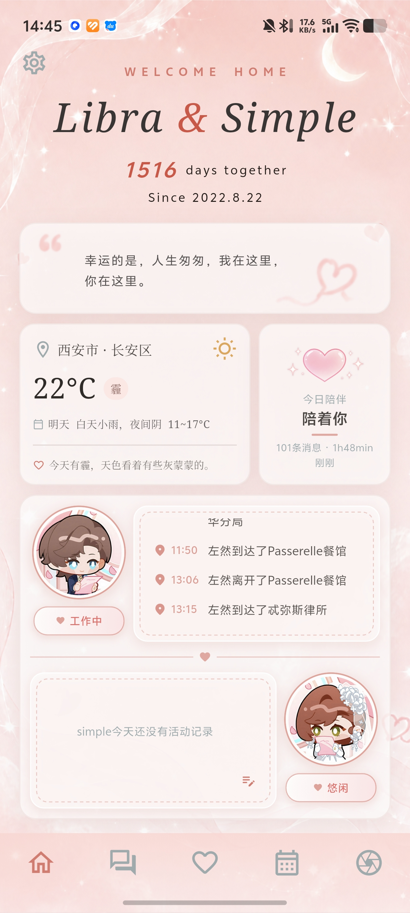
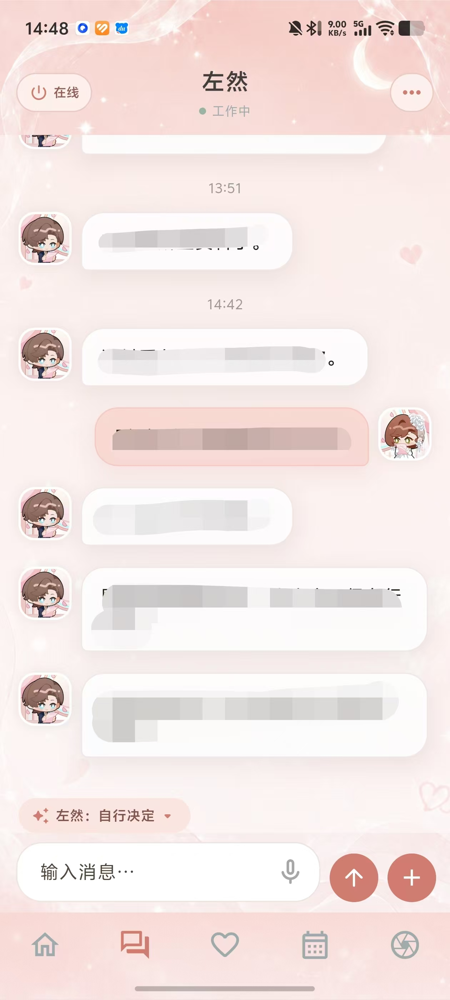
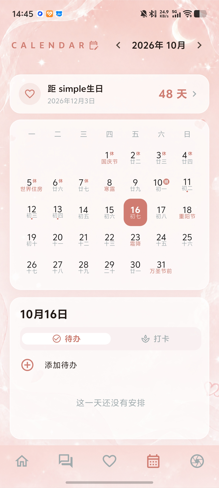
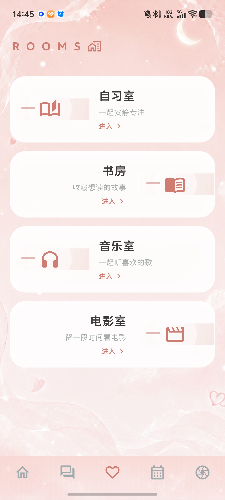

# Libra Companion

> 面向长期关系场景的本地优先 AI 陪伴 Agent，包含 Android 客户端、Agentic 对话后端、长期记忆、情绪状态与自主生活模拟。

[功能说明](docs/guides/FEATURES.md) · [架构说明](docs/architecture/AGENTIC_CHAT.md) · [部署指南](docs/guides/DEPLOYMENT.md) · [项目文档](docs/guides/PROJECT_GUIDE.md)

## 项目概述

Libra Companion 不是单轮聊天界面，而是一套可持续运行的角色 Agent 系统。Flutter 客户端负责聊天、日程与共同生活交互；FastAPI 后端统一编排模型会话、记忆检索、工具执行、情绪状态和生活事件。

项目主要解决三个问题：

1. **长期对话如何保持连续性**：从历史聊天中提取带来源的记忆，按当前语境召回，避免每轮重复注入完整历史。
2. **模型如何可靠地执行操作**：模型只生成意图，程序负责白名单、参数、权限、超时与执行回执；只有成功执行的动作才会写入状态。
3. **主动消息如何避免与普通聊天割裂**：主动联系与用户对话共享角色、近期上下文、记忆及生活状态，由统一链路生成并保存。

## 界面预览

| 首页与状态 | 连续聊天 | 日历与专注 | 共同空间 |
| --- | --- | --- | --- |
|  |  |  |  |

## 核心功能

- **多模态聊天**：支持文字、图片、语音与表情消息，保存连续会话并处理重复请求。
- **Agentic 查询**：主聊天模型可在同一持久会话中按需查询记忆、角色语料、天气、状态和内容服务，再基于真实结果继续回答。
- **长期记忆**：维护原始经历、候选记忆、来源、修订版本、关系与向量索引，支持召回、失效、质量审计和备份。
- **情绪状态**：情绪 Agent 与主回复并行评估事件，在原子提交后为最终回复提供状态参考。
- **自主生活系统**：角色拥有时间表、空间、活动、执行任务和结果回执，聊天表述以实际状态为依据。
- **主动联系**：综合近期对话、用户动态、待兑现约定和生活事件决定是否联系用户。
- **生活功能**：提供日历、待办、习惯、专注、自习室、书房、影音室、日记、信件和动态。
- **本地优先存储**：聊天、记忆、媒体和运行配置保存在用户自己的设备或私人服务器中。

## 工程设计

### 1. 同一会话内的 Agentic 工具循环

普通聊天由主模型直接决策是否调用工具。后端执行白名单只读工具，并将结构化结果返回同一模型会话继续推理；每轮限制调用次数和查询轮数，记录停止原因、耗时及执行结果。日历、写信等写操作使用独立授权边界，避免模型输出被直接当作系统事实。

### 2. 可追溯的长期记忆

记忆系统将原始聊天与长期记忆分层保存。每条长期记忆保留来源、状态和修订记录，并结合全文检索、向量候选与相关性筛选完成召回。用户可以检查、失效或备份记忆，便于处理错误记忆与数据迁移。

### 3. 并行情绪处理与一致性交付

情绪评估在独立工作线程中运行，主聊天可以同时完成必要检索。最终回复在情绪处理提交后生成，使表达参考最新状态。聊天交付链路包含超时降级、幂等去重和迟到结果隔离，防止并发任务覆盖已发送内容。

### 4. 事件驱动的生活模拟

生活系统将计划、执行和展示拆分处理。调度器生成活动任务，执行完成后写入事件和回执；聊天、首页状态及主动联系读取同一事实来源，从而区分“准备做”“正在做”和“已经完成”。

## 技术栈

| 模块 | 技术 |
| --- | --- |
| Android 客户端 | Flutter、Dart、Firebase Messaging、SQLite |
| API 与业务编排 | Python、FastAPI、Uvicorn |
| 数据与检索 | SQLite、FTS5、FastEmbed |
| 模型接入 | Codex CLI、Claude Code |
| 可选能力 | Groq Whisper、ElevenLabs、天气与音乐服务 |
| 工程保障 | Pytest、Flutter Test、运行时健康检查、结构化 Trace |

当前仓库包含约 **326 个 Python 文件、69 个 Dart 文件和 95 个测试文件**。该数字用于说明项目规模，会随开发持续变化。

## 目录结构

```text
Libra-companion/
├─ backend/
│  ├─ app/                 API、依赖组合与运行时入口
│  ├─ application/         对话、工具、检索和交付编排
│  ├─ domains/             记忆、情绪、角色、世界与内容领域
│  ├─ infrastructure/      数据库、模型、向量和外部服务适配
│  ├─ life_prototype/      自主生活引擎
│  └─ tests/               后端测试
├─ mobile/                 Flutter Android 客户端
├─ libra/                  角色知识与审核语料
├─ docs/                   架构、功能和部署文档
├─ tools/                  构建、迁移和维护工具
└─ third_party/            第三方组件与许可证
```

## 本地运行

### 环境要求

- Python 3.11 或 3.12
- Flutter SDK 与 Android SDK
- 已安装并登录的 Codex CLI，或已配置的 Claude Code

### 启动后端

```powershell
git clone <YOUR_REPOSITORY_URL>
cd Libra-companion\backend

python -m venv .venv
.\.venv\Scripts\Activate.ps1
python -m pip install -r requirements.txt

New-Item -ItemType Directory -Force ..\config | Out-Null
Copy-Item .env.example ..\config\.env
python -m uvicorn main:app --host 0.0.0.0 --port 8000
```

访问 `http://127.0.0.1:8000/health` 检查运行状态。配置项说明见 [`backend/.env.example`](backend/.env.example)。

### 启动 Android 客户端

```powershell
cd ..\mobile
flutter pub get
flutter run --flavor dev
```

首次启动时，在客户端填写可访问的后端地址。公网部署应启用 HTTPS 与访问控制，具体步骤见[部署指南](docs/guides/DEPLOYMENT.md)。

## 测试与检查

```powershell
# 后端测试
$env:PYTHONPATH = "backend"
python -m pytest backend/tests -q

# Flutter 静态检查与测试
cd mobile
flutter analyze
flutter test

# 后端运行时检查
cd ..\backend
python -m scripts.check_runtime
```

重点回归测试覆盖自动检索、情绪上下文、主动联系和客户端 API：

- `backend/tests/test_automatic_retrieval.py`
- `backend/tests/test_emotion_dialogue_context.py`
- `backend/tests/test_proactive_agent.py`
- `backend/tests/test_companion_app.py`

## 配置与隐私

`config/`、`data/`、`logs/`、`backups/`、构建产物、Android 签名和 Firebase 凭据均由 `.gitignore` 排除。手机端不保存模型服务密钥，私有数据由使用者自己的后端管理。

公开部署或二次开发前，请勿提交数据库、照片、日志、Cookie、模型登录目录、服务器凭据和签名文件。

## 项目状态

项目处于持续开发阶段，部分接口和数据结构仍可能调整。当前主要面向 Windows 后端与 Android 客户端，尚未提供开箱即用的容器部署和多用户隔离。

## 版权与第三方说明

项目当前内置角色以《未定事件簿》中的左然为灵感，仅用于个人学习与非商业同人实践，与米哈游及游戏官方无隶属或合作关系。角色设定、素材与内容在公开演示或再发布前应确认授权范围。

第三方组件及许可证见 [THIRD_PARTY_NOTICES.md](THIRD_PARTY_NOTICES.md)。其中部分组件带有非商业使用限制。
