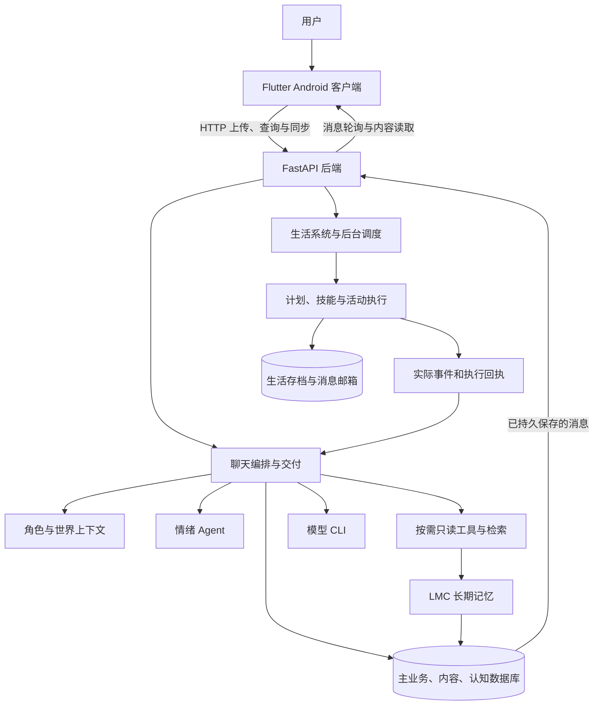
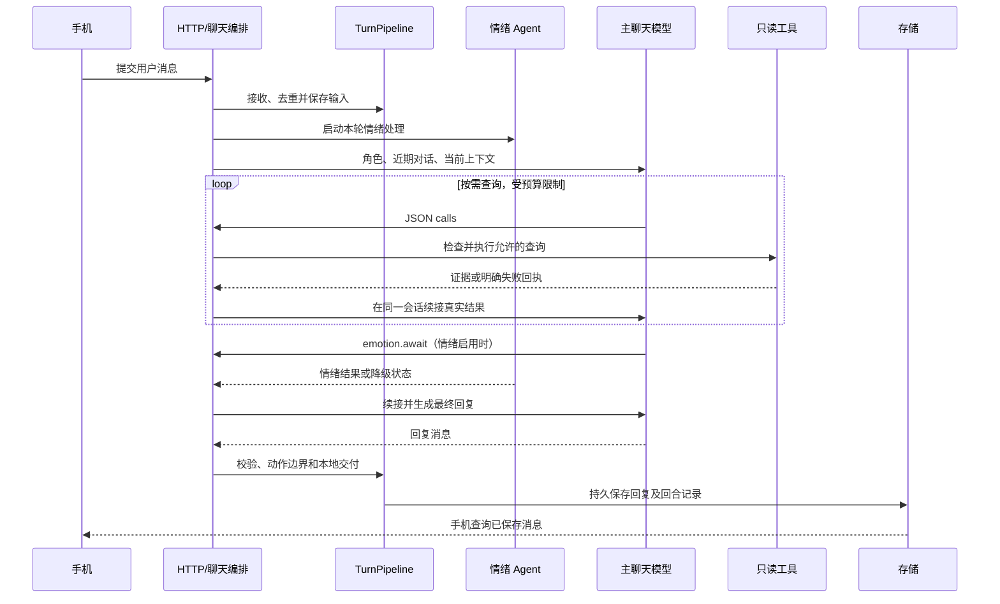

# 归然 / Libra Companion 项目理解指南

本文面向第一次接触项目的人：从产品、架构、数据和运行流程入手，解释代码为什么这样组织，以及应该从哪里开始读。技术说明依据 **2026-10-07 工作区源码**；它不是线上服务验收报告，也不读取或展示私人数据库内容。

## 目录

1. [这个项目是什么](#1-这个项目是什么)
2. [整体架构](#2-整体架构)
3. [目录和技术栈](#3-目录和技术栈)
4. [服务如何启动](#4-服务如何启动)
5. [一次聊天如何完成](#5-一次聊天如何完成)
6. [角色与情绪](#6-角色与情绪)
7. [长期记忆](#7-长期记忆)
8. [后台生活系统](#8-后台生活系统)
9. [手机端与功能入口](#9-手机端与功能入口)
10. [数据库与文件存储](#10-数据库与文件存储)
11. [HTTP 接口导航](#11-http-接口导航)
12. [配置部署与日常维护](#12-配置部署与日常维护)
13. [排查问题](#13-排查问题)
14. [如何阅读和修改代码](#14-如何阅读和修改代码)
15. [术语与进一步阅读](#15-术语与进一步阅读)

## 1. 这个项目是什么

归然是一个以角色陪伴为核心的 Android 应用。手机提供聊天和生活界面，Python 后端保存数据、调用模型、检索记忆，并推进角色的日常生活。角色设定以《未定事件簿》的左然为灵感，项目属于非官方个人学习与同人作品。

理解它时，可以先把功能分为三个部分：

| 部分 | 解决的问题 | 例子 |
|---|---|---|
| 对话 | 根据当前输入、角色设定、事实和情绪生成回应 | 聊天、语音、书影音讨论 |
| 持久记忆 | 在后续对话中接续过去的重要信息 | 偏好、约定、共同经历、事实纠正 |
| 生活系统 | 在后台规划和执行角色活动，给对话提供连续的生活背景 | 工作、吃饭、阅读、睡眠、陪伴 |

这些部分彼此连接，但有不同的职责。例如，聊天里说“下次一起看电影”可能成为一条约定；生活引擎是否真正安排活动、活动是否完成，需要另外经过计划与执行流程。模型说出的句子不能直接证明操作已经生效。

“本地优先”主要指存储和运行控制权：默认数据库、媒体、配置留在自己的机器上，也支持外置数据目录和 VPS 部署。它**不等于完全离线**：聊天模型 CLI、转写、语音合成及部分内容服务会访问网络，实际发送内容取决于调用路径和配置。

## 2. 整体架构



这里有四条边界需要记住：

- **界面和业务分开**：手机负责显示、录音、播放、设备能力和本地缓存；后端负责模型、记忆、角色生活和主要持久业务。
- **生成和执行分开**：模型提出工具调用或动作，程序检查参数、权限和当前状态，再执行允许的操作。
- **历史记录和长期记忆分开**：聊天记录保留原话；记忆系统从来源中提取、筛选和维护可召回信息。
- **交付和通知分开**：消息保存到可被手机读取的存储才算本地交付；推送通知只是提醒，不能代替消息保存。

## 3. 目录和技术栈

### 3.1 根目录

| 路径 | 内容 | 阅读建议 |
|---|---|---|
| `backend/` | Python 服务、领域逻辑、模型调用、生活引擎 | 理解运行逻辑的主入口 |
| `mobile/` | Flutter 客户端、Android 工程、图片音视频资源 | 理解页面与交互 |
| `libra/` | 角色语料、审核材料、设定、阅读与影视知识 | 理解角色材料来源 |
| `docs/` | 使用、架构、记忆、生活、角色及历史参考文档 | 按本指南链接深入 |
| `tools/` | 打包、迁移、键盘状态、一起看片和虚拟形象桥接工具 | 按需阅读独立工具说明 |
| `third_party/` | 音乐等第三方组件 | 同时阅读许可证说明 |
| `config/` | 本机 `.env`、凭据和服务配置 | 私有运行配置 |
| `data/` | 数据库、媒体、书库、生活存档 | 私有持久数据 |
| `logs/`、`backups/` | 日志与备份 | 运维与恢复 |
| `output/`、`releases/` | 本地导出、评测产物和发布文件 | 不应当作源码依据 |

### 3.2 后端分层

| 层 | 文件示例 | 主要职责 |
|---|---|---|
| 服务入口 | `main.py`、`app/runtime.py` | 创建应用、组合服务、注册路由和启动后台任务 |
| HTTP API | `app/api/models.py`、`memory.py`、`trace.py` | 请求模型和部分独立路由 |
| 用例编排 | `application/` | 把检索、生成、执行、持久化组织成完整功能 |
| 领域逻辑 | `domains/memory/`、`affect/`、`persona/`、`world/`、`content/` | 记忆、情绪、角色、世界及内容规则 |
| 基础设施 | `infrastructure/` | SQLite、路径、CLI、向量模型和天气访问 |
| 生活引擎 | `life_prototype/` | 计划、技能、活动、事件、资源和恢复机制 |
| 运维与评测 | `scripts/`、`tests/`、`evals/` | 诊断、数据维护、测试和模型场景评测 |

分层已经建立，但 `app/runtime.py` 仍承担大量路由和编排工作。找不到某个功能时，先从它的 HTTP 路由追踪，不能只凭目录名称判断全部逻辑已经移出。

`life_prototype` 虽然带有 prototype 名称，却是当前实际使用的生活引擎，保留名称是为了兼容现有导入和存档。

### 3.3 技术栈

后端使用 Python、FastAPI、Uvicorn、SQLite；FastEmbed 提供本地向量编码，NumPy、librosa 用于部分音频分析，Pillow 处理图片。`python-dotenv` 加载环境配置。主对话支持 Codex CLI 或 Claude Code；Firebase、Groq 和 ElevenLabs 分别用于配置启用时的推送、转写和语音合成。

手机端使用 Dart 和 Flutter，依赖 `http` 访问后端，`shared_preferences` 保存设置，`sqflite` 支持本地存储，并接入录音、音视频播放、图片选择、日历、定位和通知等能力。完整依赖以 `backend/requirements.txt`、`mobile/pubspec.yaml` 和锁文件为准。

## 4. 服务如何启动

后端常用入口是：

```powershell
cd backend
python -m uvicorn main:app --host 0.0.0.0 --port 8000
```

启动过程大体如下：

1. `main.py` 将模块入口兼容映射到 `app.runtime`，因此旧的 `main:app` 启动方式仍然有效。
2. `infrastructure/paths.py` 先确定配置目录，再加载 `.env`，最后确定数据、日志、备份和媒体路径。
3. `app/runtime.py` 在模块加载期间创建 FastAPI 应用、静态资源挂载和若干服务，并初始化数据库、记忆、情绪、角色资料及回合管线。
4. FastAPI startup 钩子执行生活系统启动，并开启向量预热、备份、缩略图维护、日记重试、信件、生活 tick、主动联系、记忆和情绪工作线程。
5. 手机连接后端，查询消息、状态、天气和页面内容。

数据库路径有保护检查：旧 `backend/libra.db` 尚未迁移，或已有主数据库只恢复了三个分片中的一部分，启动会明确拒绝继续。这样可以避免错误地创建空库，让旧数据看起来消失。

导入后端模块可能创建目录或初始化存储。因此，查看代码时优先读文件；运行诊断和测试时应确认使用的配置与数据目录。

## 5. 一次聊天如何完成

### 5.1 主要流程

以下是帮助理解的逻辑顺序；情绪分析和部分后台工作存在并行执行，并非所有步骤都严格串行。



### 5.2 输入与重复请求

`application/turn_pipeline.py` 的 `accept_input` 使用请求键和内容哈希检查重复请求：同一请求键、同一内容可以返回已有消息；同一键却换了内容会报冲突。它解决手机重试或网络抖动导致的重复保存问题。其他输入类型也有各自处理路径，不应把文本入口规则直接套用到所有上传接口。

### 5.3 同一主会话中的按需检索

2026-10-08 更新：普通聊天增加 `application/automatic_retrieval.py` 的有界预加载，有实质内容的输入自动召回最多四条个人记忆与两条角色参考，涉及往事、原作或共同经历时补查既定历史；纯问候跳过。模型仍可换词查证和读取已返回场景的原文。主动事件的查询计划加入最近两条不同用户话题原文，作为历史检索线索，不作为用户当前状态。自动预加载和工具查询记录分别保存；`automatic_retrieval` 记录尝试、注入数量、异常和回复中的已确认来源引用。注入不保证最终使用，来源引用也不等同于语义正确性证明。

`application/main_chat_agent.py` 和 `chat_research.py` 负责主模型的查询循环。模型可以生成最终消息，也可以先返回 JSON `calls` 请求查询。程序执行白名单工具，再把真实结果交回同一持久会话。

查询内容包括个人记忆、角色语料、既定共同历史、当前状态、当前天气及受限制的小红书搜索和读取。常规查询每轮最多两个只读调用、最多三轮；预算用尽后仍有最终回复处理。角色材料和个人记忆并非每轮固定全部搜索。

这个 JSON 查询协议由项目自己的程序解析和执行。它不是把所有能力直接暴露成主聊天模型的原生 MCP 工具。

### 5.4 情绪同步与最终回复

情绪启用时，`ChatEmotion` 在独立线程处理输入，主聊天模型在最终回复之前通过 `emotion.await` 接收结果。提前生成的回复会被拦截，随后在同一会话接收情绪结果并重新生成。等待失败或超时时，记录明确的降级状态。

因此，一条简单聊天也可能涉及多次模型调用。主会话、情绪处理、查询和生活任务还可能互相影响等待时间；不能把“最多三轮查询”理解为整条请求只有三次模型调用或固定耗时。

### 5.5 交付、动作和后续任务

`TurnPipeline` 保存回合上下文、校验结果、交付记录和后续工作。写信、修改日历等写操作经过自己的授权和执行边界，不属于上述只读查询工具。生活请求还会经过生活 Agent 的提案、校验和提交。

回答是否正确、操作是否成功、推送是否收到，是三个不同的问题。排查时分别看最终消息、执行回执和通知状态。

重点文件：`app/runtime.py`、`application/main_chat_agent.py`、`chat_research.py`、`chat_emotion.py`、`response_input.py`、`turn_pipeline.py`、`tool_decision.py`、`tool_execution.py`、`tool_contracts.py`。

## 6. 角色与情绪

### 6.1 角色从哪里来

角色表现由多个来源共同决定：`backend/persona/` 与 `prompts/` 的规则和提示词、`libra/` 的人物材料、已审核的角色语料和共同历史、当前世界与生活状态，以及实际用户互动。

`domains/persona/prompts.py` 组合不同场景的提示词；`character_corpus.py` 管理角色语料；`canonical_history.py`、`shared_history.py` 等负责既定历史与检索。角色原作材料、用户实际经历和模型暂定理解需要区分来源，不能互相冒充。

### 6.2 情绪怎样影响回应

`domains/affect/` 保存情绪事件、情绪和需求状态，并提供表达参考。它让多次互动之间有状态延续，而不是每次都从空白开始。聊天情绪 Agent 可以选择评估、更新需求或完成，不强制每条消息都执行全部评估。

程序负责结构、数值范围、事件去重和提交控制；模型负责受约束的判断。情绪状态是应用内部建模，不是对真实心理的测量。生活系统也不能因为情绪模型的一段文字就跳过自己的行动校验。

相关文件：`affect/agent.py`、`engine.py`、`contracts.py`、`service.py`、`expression.py`、`impulse.py`。

## 7. 长期记忆

### 7.1 为什么聊天记录还不够

聊天记录是逐条原话，数量增长后不适合全部塞入模型。长期记忆保存有后续意义的信息及其来源，让模型按当前主题找到相关内容。后台处理可能尚未完成，所以“记录已经保存”并不保证“已经成为正式长期记忆”。

当前分段后的运行引擎是本项目原生实现的 `lmc5-native-v2`，使用 SQLite 和现有模型接口，不需要上游 PostgreSQL 服务。

```text
原始经历 raw_experiences
  → 对话分段 experience_segments / segment_experiences
  → 持久任务 memory_jobs
  → 候选 lmc_candidates：重要性、证据、版本、风险校验
  → 正式记忆 lmc_memories + 来源、事件上下文
  → 全文、向量、关系与体验相关检索
  → 回复上下文与实际使用记录
```

### 7.2 候选和正式记忆

模型给候选评定 1–10 的重要性；通常 6 分及以上才有资格进入正式记忆，同时仍需通过证据、置信度等校验。低重要性内容可以保留为候选，并在召回剩余名额中提供相关补充。机器状态流水不会一律转成候选。

原始记录用于抽取、来源核对和纠正，不直接冒充正式召回结果。助手发言可以证明“角色曾说过某件事”，不能自动证明用户事实或某项活动已经完成。

### 7.3 五个维度

| 维度 | 意义 | 理解示例 |
|---|---|---|
| 时间 X | 事件时间、主线与时间摘要 | 区分本周约定和旧经历 |
| 关系 Y | 记忆之间有证据的联系 | 相同主题、支持或待审矛盾 |
| 事实版本 Z | 维护当前事实和历史版本 | 偏好变更后不继续当作旧偏好 |
| 体验 E | 以实际已发送回应为证据保存体验 | 后台抽取不能代写这一维 |
| 生命周期 M | 活力衰减、保护、失效与维护 | 失效来源不再作为当前证据 |

`user`、`self`、`shared` 表示不同记忆作用域，分别对应用户、角色自身和双方共同内容。未来约定不能写成已经完成的共同经历。

记忆时间目前取引用来源的时间，而非独立解析真实事件时间。因此，还需要结合原话中的“昨天”“下次”和来源时间理解事件。

### 7.4 Dream 与回顾

Dream 在合适的后台时机整合有效记忆，生成日页面及周、月、季、年摘要，也可以保存暂定反思与短期前瞻。它们属于派生理解，有来源、有效性和过期约束，不能提升为直接事实或行动权限。

手机端的日记、自动回顾和梦境历史有不同含义：日记是内容生成流程；回顾是分层记忆叙事；梦境历史保留独立篇章。读取历史篇章不等于重新将它们加入记忆召回。

代码入口：`memory/store.py`、`ingestion.py`、`extraction.py`、`lmc.py`、`lmc_recall.py`、`lmc_maintenance.py`、`dream.py`、`dream_journal.py`；分段编排在 `application/memory_segmentation.py`。更完整的约束见 [LMC 文档](../memory/LMC_MEMORY.md)。

## 8. 后台生活系统

### 8.1 它负责什么

生活系统维护角色当前活动与世界状态，生成一天的粗计划，把计划交给具体技能执行，并保存真实事件。聊天可以读取这些结果，也可以通过受约束的交互请求调整计划或陪伴安排。

```text
LocalLifeApp：加载、启停与应用集成
  → scheduler：后台调度
  → coarse_plan / coarse_plan_generator：粗计划
  → skill_router / coarse_plan_execution：选择与约束技能
  → skill_* / fine_plan：具体活动
  → activity_engine：活动事务
  → event_store：实际事件
  → 状态展示、聊天上下文、内容与记忆
```

粗计划可以理解为“今天什么时候大致做什么”；技能决定该活动怎样进行；实际事件才是已经发生的记录。计划表不等于完成记录。

### 8.2 十类技能

| 活动 | 文件 |
|---|---|
| 工作 | `skill_work.py` |
| 阅读 | `skill_reading.py` |
| 电影 | `skill_movie.py` |
| 看电视 | `skill_television.py` |
| 吃饭 | `skill_dining.py` |
| 个人护理 | `skill_personal_care.py` |
| 家务 | `skill_housework.py` |
| 运动 | `skill_exercise.py` |
| 休息 | `skill_rest.py` |
| 外出 | `skill_outing.py` |

家庭、律所、城市地点与可用资源由 `home_catalog*`、`firm_catalog.py`、`meal_places.py`、`resource_library.py` 等提供。微信读书、豆瓣、摘录本及影评模块为阅读和影视活动提供相应资料。

### 8.3 聊天与生活怎样协作

生活写入有独立存档，聊天请求通过 `application/life_agent_mailbox.py` 的独立 SQLite 邮箱交给生活侧处理，减少聊天交付直接等待生活数据库写锁的情况。

`life_agent_events.py`、`local_life.py` 和 `itinerary_reply_bridge.py` 等负责消息、操作结果与最终回应之间的连接。生活引擎有校验、操作账本、回执和恢复机制，模型提案缺少必要字段时可以被拒绝。

后台主动联系还受 `life_contact_policy.py`、`contact_decision.py` 等约束：发生了活动事件，并不意味着必须发消息。可用性、用户近期互动、冷却和主动联系设置都会影响发送。

历史文档中存在早期十维状态和退役的实验流程。当前 `state_schema.py` 是过滤历史字段的兼容层，不是继续计算十维评分的入口。阅读生活系统时，优先使用 [当前生活系统说明](../../backend/life_prototype/README.md)。

## 9. 手机端与功能入口

启动入口 `mobile/lib/main.dart` 初始化 API 配置和 Flutter，决定进入连接页还是启动页；已有连接配置时启动推送初始化。`screens/app_shell.dart` 组合主要页面并处理应用前后台、状态同步及若干周期刷新。

| 功能 | 页面或服务 | 后端关联 |
|---|---|---|
| 地址连接 | `backend_connection_page.dart`、`api_config.dart`、`backend_connection.dart` | 健康检查与后端地址 |
| 聊天与记录 | `chat_page.dart`、`chat_records_page.dart`、`libra_api.dart` | 消息、聊天、上传、收藏 |
| 首页和角色生活 | `home_page.dart`、`libra_activity_page.dart`、`life_status_display.dart` | 角色状态和生活事件 |
| 动态、日记、回顾、梦境 | `timeline_page.dart`、`diary_reading.dart`、`dream_reading.dart` | 内容及记忆阅读接口 |
| 信件与相册 | `timeline_page.dart`、`letter.dart` 模型 | letters、shared-memories |
| 日历和习惯 | `calendar_page.dart`、`calendar_service.dart`、`habit_stats_page.dart` | 日历、待办、习惯、打卡 |
| 自习和陪伴 | `study_room_page.dart`、`study_room_controller.dart`、focus 服务 | 专注记录与陪伴会话 |
| 阅读 | `book_room_page.dart`、`book_library_page.dart`、`book_detail_page.dart` | 书库、章节、讨论 |
| 音乐 | `music_room_page.dart` | 搜索、歌词、播放地址、歌单、音乐聊天 |
| 电影 | `movie_room_page.dart`、`movie_room_api.dart`、`local_movie_player_page.dart` | 影片、观影进度、讨论和一起看片 |
| 语音通话 | `call_page.dart`、录音与播放依赖 | calls、转写、低延迟回复及 TTS |
| 个性化 | `personalization_settings_page.dart`、`display_names.dart` | 称呼、配置与连接设置 |

信件和相册入口的一部分实现位于较大的页面文件中，并非每项功能都有独立同名页面。查找时可以用接口或模型名称搜索。

`services/chat_message_merge.dart`、`chat_sync_gate.dart` 等处理消息合并和同步。手机本地设置、缓存及设备权限与后端数据库分开保存，切换后端不等于复制后端数据。

Android 有 `prod` 和 `dev` 两个 flavor，包名不同，可以同时安装；dev 不初始化 Firebase，保留本地轮询通知。两套 App 只隔离手机侧数据，正式和测试后端仍需分别配置数据目录及模型会话目录。

## 10. 数据库与文件存储

电影室点击“标记看完”后，结束接口会在观影状态提交的同一事务中直接保存一条正式 LMC 共同观影记忆，包含影片名称、北京时间日期及用户完成确认的来源，不依赖聊天提取或模型重要性评分。每个观影实例只保存一次；暂停、停止采样、断线和重启不会自动记为看完。记录不证明全片连续播放，也不会补写未经确认的剧情或感受。此行为自 2026-10-08 起接入，不自动回填旧观影记录。

同一结束操作还会启动独立后台任务，依据本次观影关联的已交付电影室对话生成经历总结，概括讨论、明确表达的感受及未来约定。总结保存为观影记录的 `discussion`，并形成关联同一观影实例的讨论记忆，保留原话来源；不使用画面评论、影片摘要或其他场次聊天作为个人感受证据。没有用户讨论时不生成总结；失败标记为 error，重复点击看完可重试，基础完成记忆仍保留。超过当前输入或证据预算时明确失败，不静默截断。模型概括仍可能出错，逐字来源校验不能替代语义准确性评审。

### 10.1 三个主数据库

默认路径由 `infrastructure/paths.py` 定义，表归属由 `infrastructure/sqlite/connection.py` 定义。

| 数据库 | 主要内容 | 表示例 |
|---|---|---|
| `data/libra.db` | 核心消息、设置、设备同步及生活展示 | `messages`、`threads`、`calendar_events`、`todos`、`habits`、`mobile_state`、`movie_viewings` |
| `data/content.db` | 用户可阅读、收藏和互动的内容 | `letters`、`shared_moments`、`shared_moment_comments`、`favorite_messages`、小红书缓存 |
| `data/cognition.db` | 记忆、情绪、角色资料、认知回合及模型用量 | `lmc_*`、`raw_experiences`、`memory_jobs`、`affect_*`、`cognition_*`、`llm_usage_events` |

SQLite 连接层会挂接分片，并按表名路由 SQL。看到一段代码通过同一个连接操作多类表，并不表示这些表都在同一个物理文件中。

连接层也管理写事务和写者准入，降低并发竞争。应用层的事务不能被理解为跨生活邮箱、主数据库、文件系统和远程服务的全局事务；这些边界需要回执、去重及恢复逻辑协作。

### 10.2 其他持久数据

| 路径 | 用途 |
|---|---|
| `data/life/<run_id>/prototype.sqlite3` | 生活实例存档；run_id 区分运行实例 |
| 同实例的 `agent-mailbox.sqlite3` | 聊天与生活侧之间的消息邮箱 |
| `data/life/` 下其他运行文件 | 生活配置、账本等，依模块和实例状态而定 |
| `data/music/music.db`、`data/music/service/` | 歌单与音乐服务数据 |
| `data/uploads/` | 聊天、图片、音频和缩略图等媒体 |
| `data/private_reading/` | 用户导入的阅读内容 |
| `data/room_media/` | 影音室实际媒体 |
| `data/xhs_runs/` | 浏览任务输出 |
| `config/secrets/`、`config/music/` | 服务凭据与音乐配置 |

生活存储还把部分历史细表整合成 `life_state`、`life_evidence`、`life_receipts`，见 `life_prototype/storage_layout.py`。旧报告中的逻辑表名称不能直接当作当前物理表清单。

### 10.3 备份与迁移

更新源码时应继续挂接原数据和配置。不能只复制 `libra.db` 而漏掉其他分片、生活存档或媒体；运行中的 WAL/SHM 文件也不能单独随意删除。

`application/private_data.py` 提供应用级导出和导入，但其范围、版本兼容和完整文件迁移不是同一件事。恢复前应对照 [数据清单](DATA_INVENTORY.md) 与 [持久存储说明](PERSISTENT_STORAGE.md)，确认数据库、附件、生活存档、配置和模型会话是否分别保留。

## 11. HTTP 接口导航

这是阅读源码的代表性导航，不是完整的参数契约。运行服务后可查看 `/docs` 或 `/openapi.json` 获取实际路由和请求 schema；精确行为仍要结合处理函数。

| 类别 | 代表接口 | 代码入口 |
|---|---|---|
| 健康与状态 | `GET /health`、`GET /chat/status` | `app/runtime.py` |
| 文本聊天 | `POST /chat`、`GET /messages`、`GET /messages/updates` | runtime、main_chat_agent、turn_pipeline |
| 媒体消息 | `POST /messages/image`、`/messages/image-with-caption`、`/messages/sticker`、`/messages/voice` | runtime |
| 通话 | `POST /calls/start`、`/calls/turn`、`/calls/interrupt`、`/calls/finish` | runtime |
| 生活控制 | `GET /life-system/status`、`POST /life-system/prepare`、`/enable`、`/disable` | runtime、local_life |
| 睡眠 | `GET /sleep/status`、`POST /sleep`、`POST /wake` | runtime、生活交互 |
| 情绪 | `GET /emotion/v1/state`、`/emotion/v1/context` | runtime、affect/service |
| 记忆与回顾 | `GET /memory/dream`、`POST /memory/dream`、`GET /memory/calendar`、`GET /memory/reading` | `app/api/memory.py` |
| 相册和共同内容 | `GET /shared-memories`、`POST /shared-memories/photos`、评论接口 | runtime、content_repository |
| 信件 | `GET /letters`、`POST /letters`、已读和收藏接口 | runtime、信件编排 |
| 日历与专注 | `/calendar-events`、`/todos`、`/habits`、`/focus/sessions`、`/focus/stats` | runtime |
| 书库 | `/reading/library`、`/reading/import`、`/reading/books/{book_id}/discuss` | runtime、reading、book_library |
| 音乐 | `/music/search`、`/music/playlists`、`/music/chat` | runtime、音乐服务 |
| 电影与一起看片 | movie 和 watch 路由 | `app/api/movie_room.py`、`watch_together.py` |
| 个性化和设备 | `/personalization/settings`、`/mobile-state/{key}`、`/push/register`、`/app-presence` | runtime |
| 数据恢复 | `GET /private-data/export`、`POST /private-data/import` | runtime、private_data |
| 回合追踪 | `GET /cognition/turns`、`GET /cognition/turns/{turn_id}` 和 trace 路由 | runtime、`app/api/trace.py` |

查询接口可能包含私人内容。诊断时不要把原始响应、地址密钥、配置或日志直接公开。

## 12. 配置部署与日常维护

### 12.1 正确的配置路径

当前模板是 `backend/.env.example`，默认实际配置是项目根目录的 **`config/.env`**。部分历史文字仍写 `backend/.env`；判断当前路径应以 `infrastructure/paths.py` 和模板开头为准。

配置加载规则：先从进程环境确定 `LIBRA_CONFIG_DIR` / `LIBRA_ENV_FILE`，加载文件时不覆盖已有进程环境，再计算运行数据路径。

| 配置 | 用途 |
|---|---|
| `LIBRA_CONFIG_DIR`、`LIBRA_ENV_FILE` | 外置配置目录或指定配置文件 |
| `LIBRA_RUNTIME_DIR` | 数据根目录，默认项目根 `data/` |
| `LIBRA_BACKUP_DIR`、`LIBRA_LOG_DIR` | 备份与日志目录 |
| `LIBRA_LLM_PROVIDER`、`LIBRA_LLM_MODEL` | 主聊天 CLI 与请求模型 |
| `LIBRA_CODEX_HOME` | 可选的独立 CLI 运行与会话目录 |
| `LIBRA_AFFECT_ENABLED`、`LIBRA_DIARY_ENABLED` | 情绪和日记处理开关 |
| `GROQ_API_KEY`、`WHISPER_*` | 语音转写 |
| `ELEVENLABS_*` | 消息与通话语音合成 |
| `VOICE_CALL_LLM_*` | 通话用低延迟回复接口 |
| `LLM_*` | 兼容接口的辅助模型配置及部分回退配置 |

这张表只列理解项目最常用的项；完整模板和模块内读取项才是全部配置依据。更改模型和服务配置后应重启后端。

### 12.2 开发启动

以下是假设已经安装 Python、Flutter 和所选模型 CLI 的基本步骤；完整环境、权限和服务配置请结合 [部署指南](DEPLOYMENT.md)。

在根目录创建独立 Python 环境：

```powershell
python -m venv .venv
.\.venv\Scripts\Activate.ps1
python -m pip install -r backend/requirements.txt
New-Item -ItemType Directory -Force config
# 仅首次、config/.env 尚不存在时复制；已有配置应编辑而非覆盖
if (-not (Test-Path -LiteralPath config/.env)) {
    Copy-Item backend/.env.example config/.env
}
```

填写配置，并确认所选 CLI 能在服务运行账户下实际完成调用。随后在已激活环境的终端启动后端：

```powershell
cd backend
python -m uvicorn main:app --host 0.0.0.0 --port 8000
```

Windows 还提供 `启动后端.cmd`、`start_backend.ps1` 和计划任务重启脚本；部署脚本的日志处理与启动参数见 [后端说明](../../backend/README.md)。

另开终端，从 `mobile/` 运行：

```powershell
flutter pub get
flutter run --flavor dev
```

手机输入能够访问的后端地址。当前支持同一网络的 HTTP 地址、Tailscale 地址及已配置反向代理的 VPS HTTPS 地址；选择取决于部署方式。手机的 `127.0.0.1` 指向手机自身，不是电脑。私人 `/connect/` 地址的密钥部分也必须完整保留。

### 12.3 构建、检查与发布

```powershell
# 在 mobile/ 下
flutter analyze
flutter test
flutter build apk --release --flavor dev
flutter build apk --release --flavor prod
```

正式 App 覆盖安装需要匹配原来的签名，版本号不得降低。debug 签名的旧安装不能直接被不同 release 签名覆盖；实际发布注意事项见 [手机端说明](../../mobile/README.md)。

后端诊断统一从 `backend/` 使用模块入口：

```powershell
python -m scripts.check_text_encoding
python -m scripts.check_runtime
python -m scripts.life_status
```

`check_runtime` 不发送聊天或调用模型，用于读取健康、API 和媒体状态。具体主机、超时等参数以 `--help` 为准。数据库迁移、回填和重置是另外的维护任务，不是日常启动步骤。

从根目录执行 `python tools/package_release.py` 可生成排除本机数据和凭据的代码包。发布和升级规则见 [代码与数据边界](DEPLOYMENT_DATA_BOUNDARY.md)。

### 12.4 如何理解测试结果

`backend/tests/`、`mobile/test/` 为当前工作区测试入口；后端主要使用 unittest，具体测试可能需要额外环境。真实模型场景评测放在 `backend/evals/`，会访问模型并消耗调用资源，应与普通检查分开。

已有文档记录了 2026-10-06 的分项开发基线和未通过场景，但本指南没有重新运行应用或模型评测，也不将历史分数当作当前版本的全应用验收。评测覆盖范围、环境与局限见 [评测说明](../../backend/evals/README.md)。历史文档中“测试已删除”等说法也应结合当前文件判断。

## 13. 排查问题

主动联系在生成前结合最近 60 条交流和已召回个人记忆选择一个联系主题，保存 `contact_topic`（主题类型、角度、新增价值和证据引用）。已结束话题没有新进展时允许静默；记忆主题只能引用本轮真实返回的记忆 ID。最终生成使用该主题，发送前仍进行新意检查。主题选择与新意检查使用模型判断，不能据此保证绝不重复；错误或结构不合法时不发送，真实模型效果需要另行验证。

定时 check-in 专用于主动回忆：`MemoryStore.recollect` 独立遍历有效正式记忆，不依赖当前消息关键词命中；优先共同经历，从至少一天以前的事件、关系片段或有体验坐标的记忆中最多选一条。沿用全局六小时、单条七天的候选提供冷却，排除敏感、失效、待纠正及近期来源。冷却从提供给联系决策时计算，不代表每六小时必发。没有候选或模型认为不适合提起时保持安静；生活事件联系仍走原有流程。普通聊天与其他召回也共享自发浮现冷却。

| 现象 | 先检查什么 | 下一步 |
|---|---|---|
| 手机连不上 | 后端 `/health`、地址、网络、监听接口和防火墙 | 检查连接页与 backend_connection；确认私人地址完整 |
| 端口通但服务异常 | `/health` 的数据库和服务状态 | 看日志；检查三个主数据库是否完整 |
| 能打开页面但聊天失败 | CLI 调用、运行账户、会话目录权限 | 查看 chat/status、回合追踪和模型日志 |
| 回复很慢 | 本轮模型调用次数、检索、情绪等待 | 查看 chat_research 与 emotion_gate 追踪 |
| 新信息没有被记住 | 原始记录、分段队列、抽取任务、候选结果 | 区分待处理、低重要性、来源拒绝和召回无匹配 |
| 角色状态没有推进 | 生活系统启用状态、run_id、调度和操作回执 | 运行 life_status，查看生活存档与账本 |
| 请求调整日程却没生效 | 提案参数、动作校验、事务回执 | 以实际提交结果判断，不能只读聊天文字 |
| 手机上消息重复或缺失 | 请求键、消息保存、增量轮询与合并 | 查看 cognition_delivery 和客户端同步逻辑 |
| 有消息但没有通知 | prod/dev flavor、token、通知权限和轮询 | 将消息保存问题与推送问题分别排查 |
| 上传语音失败 | 录音权限、上传、Groq 配置、网络 | 区分录音、转写、回复、TTS 哪一步失败 |
| 书影音内容为空 | 导入结果、资源库、媒体路径、外部登录 | 区分资源未准备与模型生成失败 |
| 更新后数据像消失了 | 实际加载的 config/.env 和 RUNTIME_DIR | 核对是否指向新空目录，停止写入后确认恢复范围 |

不要直接用 `reset_memory`、删除数据库或迁移脚本尝试修复所有问题。先找到失败阶段，备份后再执行针对性的维护。

## 14. 如何阅读和修改代码

### 14.1 推荐阅读顺序

1. 本指南和根 `README.md`：建立产品、目录和数据边界概念。
2. `mobile/lib/main.dart` → `app_shell.dart` → `chat_page.dart` → `services/libra_api.dart`：看界面怎样发请求和展示结果。
3. `backend/main.py` → `app/runtime.py` 的 `/chat` 路由：找到后端调用入口。
4. `application/main_chat_agent.py` → `chat_research.py` → `turn_pipeline.py`：理解查询、情绪同步和交付。
5. `infrastructure/paths.py` → `sqlite/connection.py`：理解配置路径与数据库归属。
6. `domains/memory/` 和 `domains/affect/`：深入长期状态。
7. `application/local_life.py` → `life_prototype/scheduler.py` → 一项 `skill_*`：深入后台生活。

初次阅读可以只追踪一条文本消息，不必先读完全部技能和第三方组件。

### 14.2 根据目标定位修改

| 想修改什么 | 优先入口 | 需要一起确认 |
|---|---|---|
| 页面布局和文字 | `mobile/lib/screens/`、widgets | 加载、空数据和错误状态 |
| 称呼与稳定人设 | persona、prompts、个性化设置 | 是否应通过设置修改而非硬编码 |
| 回复输入与查询 | response_input、main_chat_agent、chat_research | 会话续接、预算和情绪边界 |
| 新只读工具 | tool_contracts、tool_decision、tool_execution、检索适配 | 参数、可访问来源和失败回执 |
| 写操作 | application 的执行用例 | 授权、去重、实际提交及恢复 |
| 记忆门槛或召回 | lmc、lmc_recall | 来源、作用域、纠正、敏感性与历史版本 |
| 生活行为 | 对应 skill、router、activity_engine | 时间、地点、资源和活动事务 |
| 数据路径或分片 | infrastructure/paths、sqlite/connection | 现有存档兼容与备份恢复 |
| 媒体或网络功能 | runtime 路由和对应 service | 手机权限、文件保存和外部依赖 |

修改跨模块行为时应沿调用链验证。例如新增一个电影讨论能力，可能同时涉及手机 API、HTTP 模型、电影用例、书影音资源、聊天 source 路由和消息展示，不能只新增一个按钮。

### 14.3 开发环境隔离

测试后端应使用独立配置、数据和 CLI 会话目录；复制正式数据时必须按迁移说明处理会话键和推送 token，避免测试影响正式会话或手机通知。源码目录相同与运行状态相同是两回事。

不要批量修改已持久化的世界配置来源字符串。部分字符串参与配置一致性和人物指纹校验，文档移动不意味着存档中的引用可以随意改写。

## 15. 术语与进一步阅读

| 术语 | 在本项目中的意思 |
|---|---|
| Agent | 根据状态和输入提出下一步的模型与程序组合；执行仍受宿主约束 |
| turn / 回合 | 一次输入、上下文、生成、校验和交付的处理单元 |
| thread / session | 模型持久会话标识；与手机聊天页面和单条消息不同 |
| source / 来源 | 消息、记忆、事件或资料的来源类别与可核对证据 |
| recall / 召回 | 从记忆或资料中选出与当前输入相关的内容 |
| embedding / 向量 | 为文本编码的数值表示，用于语义相关检索 |
| FTS / 全文检索 | 按文本索引搜索，和向量检索的能力与依赖不同 |
| schema / 契约 | 数据结构、字段类型及约束 |
| lease / 租约 | 后台任务在一段时间内由某个处理者持有的执行资格 |
| receipt / 回执 | 程序实际执行的结果，说明提交成功或失败原因 |
| inbox / outbox | 接收待处理输入与保存待投递结果的持久队列 |
| trace / 追踪 | 用于解释一次回合中决策、调用、校验和交付的记录 |
| run_id | 生活实例的标识，用来定位独立存档 |
| flavor | Android 构建变体；本项目用于正式版与测试版 |

按需要继续阅读：

- [功能与实现说明](FEATURES.md)：按产品功能展开。
- [部署指南](DEPLOYMENT.md)、[持久存储](PERSISTENT_STORAGE.md)、[数据清单](DATA_INVENTORY.md)：部署、升级和恢复。
- [聊天按需查询](../architecture/AGENTIC_CHAT.md)：主会话工具循环和情绪同步。
- [后端职责边界](../architecture/backend_ownership.md)、[SQLite 写事务](../architecture/sqlite-write-transactions.md)：模块归属与并发。
- [LMC 记忆系统](../memory/LMC_MEMORY.md)：记忆来源、事实版本、召回、Dream 和恢复。
- [当前生活系统](../../backend/life_prototype/README.md)、[生活与聊天 Agent](../life/life_chat_agents.md)、[聊天优先与生活后台并发](../life/聊天优先与生活后台并发.md)：生活执行和交互。
- [维护命令](../../backend/scripts/README.md)、[评测说明](../../backend/evals/README.md)：诊断、数据操作和验证范围。
- [第三方说明](../../THIRD_PARTY_NOTICES.md)：组件与素材的授权边界。

文档之间出现差异时，先确认它是否标注为历史快照或设计参考，再查当前源码、路径模板和实际 API 契约。本指南描述当前代码组织；实例启用状态、外部服务可用性和实际数据是否完整，需要运行时另外检查。
