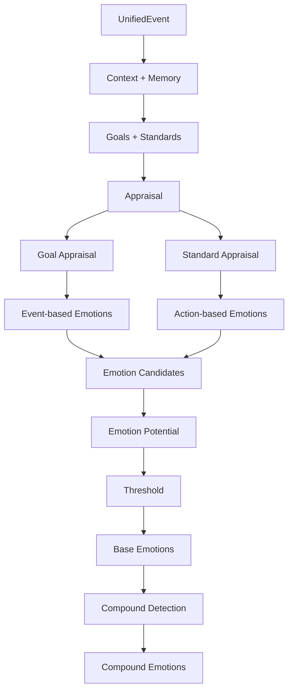

## 1. 整体目标
情绪系统的目标不是让 Libra 简单拥有一个 mood 数值，而是让他能够：
- 理解一件事对自己、用户、关系意味着什么
- 根据自己的 Goals 和 Standards 产生不同情绪
- 允许多种情绪同时存在
- 让情绪具有强度、持续、累积和衰减
- 进一步影响 Need / Desire
- 最终影响主动行为和回复方式

### 1.1 文档职责与权威顺序

本文档负责总体架构、状态流转和模块关系。为避免同一接口在多处重复定义，V1 采用以下权威顺序：

```text
UnifiedEvent 字段与枚举
→ Libra_UnifiedEvent_V1_规格.md

Core / Active Goal 定义与权重
→ Libra_Goal_System_V1_ActiveGoal继承Core权重版.md

Standards 定义与 importance
→ Libra_Standards_V1_最终版.md

LLM Appraisal 输入输出
→ Libra_Appraisal_Prompt_JSONSchema_V1.md

LLM Need Update 输入输出
→ Libra_Need_Update_Prompt_JSONSchema_V1.md
```

本文档中的结构示例必须与上述专项文档保持一致；实现时以专项文档和 JSON Schema 为准。

整体架构


## 2. Appraisal
Appraisal回答的问题是：“这件事情对 Libra 来说意味着什么？”

event→ appraisal→ emotion
取代了原来的从event得到emotion的具体数值


### 2.1 整体架构
```markdown
UnifiedEvent + Current Context + Relevant Memory + Goals + Standards
↓
Appraisal
├─ 这件事主要影响谁？
│
├─ Goal Appraisal
│  ├─ 匹配了哪些 Goal？
│  ├─ 对每个 Goal 是 promote / hinder / neutral？
│  ├─ impact_strength 多大？
│  └─ desire_force 多大？
│
└─ Standard Appraisal(if has)
   ├─ 是否存在需要评价的行为？
   ├─ 匹配了哪个 Standard？
   ├─ praiseworthy / blameworthy / neutral？
   ├─ evaluation_strength 多大？
   └─ Standard importance 多大？
↓
AppraisalResult
```

```json
{
  "event_id": "evt_xxx",

  "goal_appraisals": [
    {
      "target": "user",
      "goal_id": "active_user_rest_well",
      "goal_description": "希望用户今晚能够好好休息",
      "parent_core_goal_id": "goal_user_wellbeing",
      "impact": "promote",
      "impact_strength": 0.65,
      "desire_force": 0.95,
      "prospect_status": "none",
      "prospect": null
    }
  ],

  "standard_appraisals": [
    {
      "actor": "user",
      "standard_id": "std_responsibility",
      "evaluation": "praiseworthy",
      "evaluation_strength": 0.70,
      "importance": 0.90
    }
  ]
}
```

### 2.2 Appraisal输入

#### 2.2.1 UnifiedEvent
情绪系统不直接读取各种零散业务事件，而是统一接收 `UnifiedEvent`。

V1 的 UnifiedEvent 保持轻量，只负责回答：

- 这是什么事件
- 事件来自哪里
- 主要发生在谁身上
- 事件本质是什么
- 发生了什么
- 什么时候发生
- 当前是瞬时事件还是持续状态

结构：

```json
{
  "event_id": "evt_xxx",

  "source": "user_life_activity",

  "subject": "user",

  "event_type": "state_transition",

  "description": "用户从工作状态进入通勤状态",

  "occurred_at": "2026-09-02T18:10:00+08:00",

  "scope": "instant"
}
```

字段含义：

- `event_id`：事件唯一标识
- `source`：事件由哪个模块产生
- `subject`：事件主要发生在谁身上
- `event_type`：事件本质
- `description`：完整、明确的自然语言事实描述
- `occurred_at`：事件实际发生时间
- `scope`：事件的时间性质，枚举值 `instant / ongoing`

V1 不额外设计 `facts`。

因此 `description` 需要承担 Appraisal 所需的主要语义信息，尽量写成完整、明确、无歧义的事实句。

例如：

```text
不推荐：
下班了

推荐：
Libra 结束了今天的工作，当前准备离开律所回家。
```

```text
不推荐：
状态变了

推荐：
用户将自己的状态从“工作中”修改为“疲惫”。
```

后续如果实际运行中出现事件优先级、事件关联或规则化解析需求，再单独扩展 UnifiedEvent。

UnifiedEvent 的完整枚举与 Trigger Source 对应关系由独立的 UnifiedEvent 规格文档维护。

#### 2.2.2 Goals
Goals 的含义是：Libra 希望某种状态、结果或事情发生。

```text
GoalSystem
├─ Core Goals
│  └─ 核心目标，长期稳定
└─ Active Goals
   └─ Appraisal 时根据 Event / Context 动态生成的具体目标
```

Core Goal Schema：

```json
{
  "goal_id": "goal_user_wellbeing",
  "name": "用户状态良好",
  "description": "希望用户的身体、情绪和生活状态总体良好",
  "target": "user",
  "type": "core",
  "base_desire_force": 0.95,
  "status": "active"
}
```

字段含义：

- `goal_id`：Goal 唯一标识
- `name`：简短名称
- `description`：Goal 的具体语义，供 Appraisal 匹配
- `target`：枚举值 `user / libra / relationship / other`
- `type`：Core Goal 固定为 `core`
- `base_desire_force`：Libra 对该 Core Goal 的基础重视程度，范围 `0~1`
- `status`：Core Goal 在 V1 中长期为 `active`

Active Goal 由 Appraisal 临时生成，包含：

```text
goal_id
goal_description
target
type = active
parent_core_goal_id
```

Active Goal 不保存 `base_desire_force`，不维护 `completed / failed / expired` 生命周期，也默认不作为独立长期状态持久化。未来结果的跨时间追踪统一由 `ProspectState` 负责。

#### desire_force 的来源

`desire_force` 不建议每次完全由 LLM 自由生成。

V1 采用：

```text
Goal.base_desire_force
↓
结合 Current Context 做有限调整
↓
本次 Appraisal.desire_force
```

即：

```text
desire_force = clamp(base_desire_force + context_adjustment, 0, 1)
```

其中 `context_adjustment` 为小幅修正值，建议限制在较小范围内，例如 `[-0.15, +0.15]`。

这样可以避免同一个长期 Goal 在相似 Event 下因为模型随机性出现过大波动。

Core Goal 的具体清单、描述和 `base_desire_force` 需要作为独立配置维护。

#### 2.2.3 Standards
Standards 可以理解为 Libra 判断某种行为是否值得认可、是否合适的内部价值标准。

Standards 长期稳定。

推荐 Standard Schema：

```json
{
  "standard_id": "std_responsibility",
  "name": "责任感",
  "description": "认真对待自己已经承担的责任、任务和承诺",
  "importance": 0.90,
  "enabled": true
}
```

字段含义：

- `standard_id`：Standard 唯一标识
- `name`：简短名称
- `description`：该价值标准的具体语义，供 Appraisal 匹配
- `importance`：该 Standard 对 Libra 的稳定重要程度，范围 `0~1`
- `enabled`：当前是否启用

`importance` 属于 Standard 自身配置，不由每次 Appraisal 临时生成。

因此 Standard Appraisal 的语义模型主要负责判断：

```text
是否命中某个 Standard
+
praiseworthy / blameworthy / neutral
+
evaluation_strength
```

而 `importance` 由程序根据 `standard_id` 从 Standard 配置中读取。

Standards 的具体清单、描述和 `importance` 需要作为独立配置维护。

### 2.3 Appraisal的核心
```markdown
Appraisal
├─ Goal Appraisal
└─ Standard Appraisal
```
自然语言描述就是
```markdown
这件事影响了谁？
↓
影响了哪个 Goal？
↓
促进还是阻碍这个 Goal？
↓
Libra 有多希望这个 Goal 实现？
↓
事件中是否存在需要评价的行为？
↓
这个行为符合还是违反哪个 Standard？
↓
这个 Standard 对 Libra 有多重要？
```

#### 2.3.1 Goal Appraisal 
goal appraisal可以理解为event对Libra所关心的目标产生了什么影响。

```json
{
  "target": "user",
  "goal_id": "active_exam_go_well",
  "goal_description": "希望用户这次考试顺利",
  "parent_core_goal_id": "goal_user_important_things_go_well",
  "impact": "promote",
  "impact_strength": 0.75,
  "desire_force": 0.95,
  "prospect_status": "none",
  "prospect": null
}
```
字段的含义
- target：目标关联的对象，枚举值（user, libra, relationship, other）
- goal_id：事件级追溯 ID，不作为跨 Event 的稳定匹配键
- goal_description
- parent_core_goal_id
- impact：event对目标产生的影响，枚举值（promote, hinder, neutral）
- impact_strength：影响程度，numeric，0~1
- desire_force：Libra有多希望该goal实现，numeric，0~1
- prospect_status：该 Goal 是否涉及未来预期
	- none：普通事件，不涉及未来预期
	- anticipated：未来结果尚未确定
	- confirmed：之前预期的结果后来被确认
	- disconfirmed：之前预期的结果后来被否定
- prospect：仅在 `anticipated` 时提供 `expected_outcome / outcome_type / valid_until`；其他状态固定为 `null`

#### 2.3.2  Standard  Appraisal 
standard appraisal可以理解为event包含的行为是否符合Libra的价值判断。
部分事件没有行为，例如天气变化..，则跳过standard appraisal

{
  "actor": "user",
  "standard_id": "std_responsibility",
  "evaluation": "praiseworthy",
  "evaluation_strength": 0.72,
  "importance": 0.90
}

字段的含义
- actor：谁做了这个行为，枚举值（user, libra, other）
- standard_id：命中的standard
- evaluation：枚举值（praiseworthy, blameworthy, neutral）
- evaluation_strength: 符合/违法standard的程度，0~1
- importance：这个 standard对Libra的重要程度，0~1

！！！ 一个event可以匹配多个goal/standard


### 2.4 Appraisal 的执行边界

Appraisal 包含大量语义判断，例如：

- Event 匹配哪个 Goal
- Event 是促进还是阻碍 Goal
- 影响程度有多大
- Event 中是否存在需要价值评价的行为
- 行为命中了哪个 Standard
- 符合或违反 Standard 的程度

这部分不适合全部写成固定规则。

Libra V1 采用：

```text
语义判断
→ LLM

确定性数学计算与状态更新
→ Python
```

具体职责如下。

#### LLM 负责

- 从启用的 Core Goals 中判断本 Event 命中的 Goal，并生成对应 Active Goal
- 输出 `impact`
- 输出 `impact_strength`
- 对 `base_desire_force` 做必要的小幅 Context 修正
- 判断是否存在可归因、可评价的行为
- 从候选 Standards 中判断命中的 Standard
- 输出 `evaluation`
- 输出 `evaluation_strength`
- 在 Prospect Matching 已提供结果时，将结果写入对应 `prospect_status`

LLM 必须输出严格结构化 JSON，并经过 Schema 校验。

#### Python 负责

- 根据 `parent_core_goal_id` 读取 Core Goal 配置
- 根据 `standard_id` 读取 Standard 配置
- clamp 所有数值范围
- Emotion Candidate 映射
- Emotion Potential
- Threshold
- Initial Intensity
- Compound Detection
- Emotion Decay
- Emotion Aggregation
- Prospect 状态维护
- PAD Mapping
- Virtual Emotion Center
- Mood Dynamics
- Need 数值更新
- Need Recovery

原则：

**LLM 不负责执行情绪公式，不直接输出最终 Emotion intensity、Mood 或 Need value。**

这样可以保证同一 AppraisalResult 在相同配置下得到确定性的状态更新结果。

### 2.5 Prospect State

ProspectState 用于记录尚未得到结果的未来预期。

当 `prospect_status = anticipated` 且 `hope` 或 `fear` 成功通过 Threshold 被激活时，使用 Goal Appraisal 的 `prospect` 元数据创建一条 pending ProspectState。若没有成功激活，则不创建。

示例：

```json
{
  "prospect_id": "prospect_001",
  "source_active_goal_id": "active_user_trip_go_well",
  "parent_core_goal_id": "goal_user_important_things_go_well",
  "target": "user",
  "expected_outcome": "周末下雨导致出游受阻",
  "outcome_type": "trip_disrupted_by_rain",
  "emotion": "fear",
  "status": "pending",
  "valid_until": "..."
}
```

字段含义：

- `prospect_id`：ProspectState 的唯一标识
- `source_active_goal_id`：创建 Prospect 时的事件级 Active Goal ID，仅用于追溯，不作为跨事件匹配键
- `parent_core_goal_id`：该 Active Goal 继承的 Core Goal ID，作为稳定匹配条件之一
- `target`：Goal 关联对象，枚举值（`user`, `libra`, `relationship`, `other`）
- `expected_outcome`：Libra 当前期待或担心的未来结果，自然语言描述
- `outcome_type`：未来结果的结构化类型，用于后续 Prospect Matching
- `emotion`：当前预期情绪，枚举值（`hope`, `fear`）
- `status`：当前状态，枚举值（`pending`, `resolved`, `expired`）
- `valid_until`：该 Prospect 的有效截止时间


**status 自动更新规则**
status 由系统自动维护：
- 创建 ProspectState → pending
- 后续 Event 匹配成功，且结果已经明确落地 → resolved
- 当前时间超过 valid_until，且仍未得到明确结果 → expired
Prospect Matching 只检索 status = pending 的记录。

### 2.6 Prospect Matching

当新 Event 到来时，系统查找 `status = pending` 的 ProspectState。

匹配分两步：

1. 规则筛选
   - 时间仍有效
   - target / parent_core_goal_id 相关
   - outcome_type 相关

2. 语义确认
   - 比较当前 Event 与 `expected_outcome`
   - 判断当前 Event 是否确认或否定此前预期

匹配成功：
- 预期结果发生 → `confirmed`
- 预期结果没有发生 → `disconfirmed`

匹配失败：
- 不生成 satisfaction / disappointment / relief / fears_confirmed
- 当前 Event 只按普通 Goal Appraisal 处理

```text
  "matched_prospect": {
    "prospect_id": "prospect_001",
    "previous_emotion": "hope",
    "parent_core_goal_id": "goal_user_important_things_go_well",
    "target": "user",
    "expected_outcome": "用户这次考试顺利",
    "outcome_type": "exam_result",
    "initial_potential": 0.76,
    "resolution": "confirmed"
  }
```

### 2.7 Prospect Resolution 记录

为了能够追踪一个 Prospect 是如何被后续 Event 解决的，V1 持久化时统一使用以下完整结构：

```json
{
  "prospect_id": "prospect_001",
  "source_event_id": "evt_create",
  "source_active_goal_id": "active_user_trip_go_well",
  "parent_core_goal_id": "goal_user_important_things_go_well",
  "target": "user",
  "expected_outcome": "周末下雨导致出游受阻",
  "outcome_type": "trip_disrupted_by_rain",
  "emotion": "fear",
  "initial_potential": 0.76,
  "status": "pending",
  "created_at": "2026-09-03T12:00:00+08:00",
  "valid_until": "2026-09-06T23:59:59+08:00",
  "resolved_at": null,
  "resolution_event_id": null,
  "resolution": null
}
```

持久化字段补充说明：

- `source_event_id`：创建该 Prospect 的原始 Event
- `initial_potential`：最初激活 `hope / fear` 时的 Prospect Potential
- `created_at`：创建时间
- `resolved_at`：得到明确结果的时间
- `resolution_event_id`：使 Prospect 被确认或否定的 Event
- `resolution`：枚举值 `confirmed / disconfirmed / expired / null`

其中：

- `status = pending`：等待结果
- `status = resolved`：已通过新 Event 明确确认或否定
- `status = expired`：超过有效期且未得到明确结果

`resolution` 用于记录最终是确认、否定还是过期。

状态字段必须满足以下不变量：

```text
status = pending
→ resolution = null
→ resolved_at = null
→ resolution_event_id = null

status = resolved
→ resolution = confirmed / disconfirmed
→ resolved_at 与 resolution_event_id 均非 null

status = expired
→ resolution = expired
→ resolved_at 非 null
→ resolution_event_id = null
```

除 `resolution_event_id` 在过期时允许为 `null` 外，上述完整结构中的字段均应持久化。所有时间字段统一使用带时区 ISO 8601。

## 3 Emotion Type
Libra V1 一共设计 18 种情绪：8 种基础情绪、6 种 Prospect-based 情绪和 4 种复合情绪。

### 3.1 基础情绪
- joy
- distress
- happy_for
- sorry_for
- pride
- shame
- admiration
- reproach

### 3.2 Prospect-based Emotions 
用于处理尚未确定、面向未来的事件结果。
- hope
- fear
- satisfaction
- disappointment
- relief
- fears_confirmed

### 3.3 复合情绪
- pride + joy→ gratification
- admiration + joy→ gratitude
- shame + distress→ remorse
- reproach + distress→ anger

### 3.4 Emotion Semantics

情绪枚举仅用于 Libra 内部心理状态表示，不等同于最终自然语言表达。

- `joy`：因自身目标被促进而产生的愉悦。
- `distress`：因自身目标被阻碍而产生的不快、难受。
- `happy_for`：因在意对象的目标被促进，而替对方感到高兴。
- `sorry_for`：因在意对象的目标被阻碍，而替对方感到遗憾或难过。  
  注意：不表示“道歉”或“对不起”。
- `pride`：对自己符合重要 Standard 的行为产生积极评价。
- `shame`：对自己违反重要 Standard 的行为产生消极评价。
- `admiration`：对他人符合重要 Standard 的行为产生认可、欣赏。
- `reproach`：对他人违反重要 Standard 的行为产生责难性负面评价。

- `hope`：希望某个未来结果发生，并认为它有可能实现。
- `fear`：不希望某个未来结果发生，但认为它有可能发生。 
- `satisfaction`：之前期待的结果最终实现。 
- `disappointment`：之前期待的结果最终没有实现。
- `relief`：之前担心的坏结果最终没有发生。 
- `fears_confirmed`：之前担心的坏结果最终真的发生。

复合情绪：
- `gratification`：`pride + joy`
- `gratitude`：`admiration + joy`
- `remorse`：`shame + distress`
- `anger`：`reproach + distress`


注意：
这些情绪名称是内部状态标签，不应直接翻译成 Libra 的台词。
最终表达应由后续 Expression Strategy 根据情绪、上下文、记忆和角色风格生成。

## 4 Emotion Elicitation
根据 AppraisalResult 判断这次事件触发什么情绪，以及初始强度是多少。

### 4.1 Goal Appraisal → Emotion

Goal Appraisal 用于判断 Event 对 Libra 所关心的 Goal 产生了什么影响，并据此生成 Goal-based Emotion Candidate。

#### 普通已发生事件( `prospect_status = none`)
当 `impact = neutral` 时，不生成 Goal-based Emotion。

##### target = libra
- `impact = promote` → `joy`
- `impact = hinder` → `distress`
- `impact = neutral` → 不生成 Goal-based Emotion

##### target = user
当 Libra 希望该 Goal 实现，即 `desire_force > 0` 时：
- `impact = promote` → `happy_for`
- `impact = hinder` → `sorry_for`
- `impact = neutral` → 不生成 Goal-based Emotion

##### target = relationship
表示 Event 影响的是 Libra 与用户之间的关系目标，例如：
- 沟通顺利
- 共同计划完成
- 承诺履行
- 关系稳定
- 冲突、误会或疏远

映射：
- `impact = promote` → `joy`
- `impact = hinder` → `distress`
- `impact = neutral` → 不生成 Emotion

##### target = other
表示 Event 主要影响第三方。

当 Libra 希望该对象的 Goal 实现，即 `desire_force > 0` 时：
- `impact = promote` → `happy_for`
- `impact = hinder` → `sorry_for`

##### 汇总

- `joy`：Libra 自身 Goal 被促进
- `distress`：Libra 自身 Goal 被阻碍
- `happy_for`：用户 Goal 被促进，Libra 因此替用户感到高兴
- `sorry_for`：用户 Goal 被阻碍，Libra 因此替用户感到遗憾或难过，不表示“道歉”

| target | promote | hinder |
|---|---|---|
| `libra` | `joy` | `distress` |
| `user` | `happy_for` | `sorry_for` |
| `relationship` | `joy` | `distress` |
| `other` | `happy_for` | `sorry_for` |

一个 Event 可以同时匹配多个 target / Goal，并产生多个 Emotion Candidate。

#### Future / Prospect Event

当 `prospect_status = anticipated` 时：

- `impact = promote`：预期结果会促进 Active Goal → `hope`
- `impact = hinder`：预期结果会阻碍 Active Goal → `fear`
- `impact = neutral`：不创建 Prospect，也不生成 Prospect-based Emotion

当 `prospect_status = confirmed` 时：
- `hope + confirmed` → `satisfaction`
- `fear + confirmed` → `fears_confirmed`

当 `prospect_status = disconfirmed` 时：
- `hope + disconfirmed` → `disappointment`
- `fear + disconfirmed` → `relief`

Resolution 时的 Goal impact 必须与预期方向一致：

```text
hope  + confirmed    → promote
hope  + disconfirmed → hinder
fear  + confirmed    → hinder
fear  + disconfirmed → promote
```
### 4.2 Standard Appraisal → Emotion

Standard Appraisal 仅在 Event 中存在可归因、可评价的行为时进行。

如果 Event 不包含需要进行价值判断的行为，例如天气变化、自然环境变化等，则：

`standard_appraisals = []`

#### actor = libra
- `evaluation = praiseworthy` → `pride`
- `evaluation = blameworthy` → `shame`
- `evaluation = neutral` → 不生成 Standard-based Emotion

#### actor = user / other
- `evaluation = praiseworthy` → `admiration`
- `evaluation = blameworthy` → `reproach`
- `evaluation = neutral` → 不生成 Standard-based Emotion

其中：
- `pride`：Libra 对自己的行为作出积极评价
- `shame`：Libra 对自己的行为作出消极评价
- `admiration`：Libra 对他人的行为产生认可或欣赏
- `reproach`：Libra 对他人的行为产生责难性的负面评价

### 4.3 Emotion Potential
Appraisal 命中某种 Emotion，并不代表该 Emotion 一定会真正被激活。
Emotion Potential 表示：本次 Appraisal 对某种 Emotion 提供了多强的初始激活潜力。

#### 4.3.1 Goal-based Emotion Potential
对于由 Goal Appraisal 产生的 Emotion：

`potential = impact_strength × desire_force`

其中：
- `impact_strength`：本次 Event 对对应 Goal 的促进或阻碍程度，范围 `0~1`
- `desire_force`：Libra 有多希望该 Goal 实现，范围 `0~1`

因此：
`potential ∈ [0, 1]`
例如：
- `impact_strength = 0.8`
- `desire_force = 0.9`
则：
`potential = 0.72`

该公式适用于：
- `joy`
- `distress`
- `happy_for`
- `sorry_for`

#### 4.3.2 Standard-based Emotion Potential
对于由 Standard Appraisal 产生的 Emotion：
`potential = evaluation_strength × importance`
其中：

- `evaluation_strength`：该行为符合或违反 Standard 的程度，范围 `0~1`
- `importance`：该 Standard 对 Libra 的重要程度，范围 `0~1`

因此：
`potential ∈ [0, 1]`

例如：
- `evaluation_strength = 0.75`
- `importance = 0.8`

则：
`potential = 0.60`
该公式适用于：
- `pride`
- `shame`
- `admiration`
- `reproach`

当前 Emotion Potential 的计算方式属于 Libra 的工程化设计。

其基本思路参考论文中：
- Goal 对事件后果的 desirability / undesirability
- Standard 对行为的 praiseworthiness / blameworthiness

但当前实现不直接复现论文中的完整概率逻辑公式，而使用更适合实际系统实现的归一化强度计算。

#### 4.3.3 Prospect-based Emotion Potential

Prospect-based Emotion 分为两类：

1. 尚未确定结果时的 `hope / fear`
2. Prospect 被后续 Event 解决后的 `satisfaction / disappointment / relief / fears_confirmed`

##### hope / fear

当 `prospect_status = anticipated` 时，沿用 Goal-based Potential：

```text
prospect_potential = impact_strength × desire_force
```

如果预期结果会促进 Active Goal，即 `impact = promote`：

```text
→ hope
```

如果预期结果会阻碍 Active Goal，即 `impact = hinder`：

```text
→ fear
```

当 `hope / fear` 被成功激活时，将该次 `prospect_potential` 保存到对应 `ProspectState.initial_potential`。

##### satisfaction / disappointment / relief / fears_confirmed

当后续 Event 成功匹配某条 pending Prospect，并明确确认或否定结果时，V1 不增加新的模型字段，直接使用对应 Resolution Goal Appraisal 的 `impact_strength`：

```text
resolution_strength = matched_goal_appraisal.impact_strength
```

它表示当前 Event 对对应 Goal 的直接影响程度，也作为对此前预期结果的确认/否定强度。

V1 计算：

```text
resolution_potential
=
ProspectState.initial_potential × resolution_strength
```

映射：

```text
previous emotion = hope
+ confirmed
→ satisfaction

previous emotion = hope
+ disconfirmed
→ disappointment

previous emotion = fear
+ confirmed
→ fears_confirmed

previous emotion = fear
+ disconfirmed
→ relief
```

对应 Emotion 再使用自己的 Threshold 判断是否激活。

例如：

```text
previous hope potential = 0.75
resolution_strength = 1.00

satisfaction potential
= 0.75 × 1.00
= 0.75
```

如果：

```text
satisfaction threshold = 0.45
```

则激活 satisfaction，并使用统一的 initial intensity 公式。

说明：

如果 Prospect Matching 失败，则当前 Event 不生成上述 Resolution Emotion，仅按照普通 Goal Appraisal 处理。

### 4.4 Emotion Threshold
每种 Emotion 都有独立的 `threshold`。
`threshold` 表示：Libra 被单次 Event 激活该种情绪所需要达到的最低门槛。

判断规则：
- `potential <= threshold` → 不生成该 Emotion
- `potential > threshold` → 激活该 Emotion，并进入后续 intensity 计算

`threshold` 越低，说明该情绪越容易被触发；
`threshold` 越高，说明该情绪越难被触发。

| Emotion         | Threshold |
|---------|----------|
| joy             | 0.45      |
| distress        | 0.55      |
| happy_for       | 0.3      |
| sorry_for       | 0.35      |
| hope            | 0.4      |
| fear            | 0.70      |
| satisfaction    | 0.45      |
| disappointment  | 0.50      |
| relief          | 0.40      |
| fears_confirmed | 0.65      |
| pride           | 0.60     |
| shame           | 0.55      |
| admiration      | 0.35      |
| reproach        | 0.55      |
| gratification   | 0.45      |
| gratitude       | 0.25      |
| remorse         | 0.4      |
| anger           | 0.75 |


### 4.5 Emotion Intensity

当 `potential > threshold` 时，该 Emotion 被激活，并计算本次 Event 产生的初始强度。

计算：
`initial_intensity = (potential - threshold) / (1 - threshold)`

其中：
- `potential`：Emotion Potential，0~1
- `threshold`：该 Emotion 的激活阈值，0~1
- `initial_intensity`：本次 Event 新产生的情绪强度，0~1

当：
`potential <= threshold`
则：
`initial_intensity = 0`

该值仅表示当前 Event 新产生的情绪刺激，
不是 Libra 当前总体 EmotionalState。

### 4.6 Compound Emotion Potential

复合情绪由两个已经被激活的基础情绪共同产生。

只有当组成该复合情绪的两个 Base Emotion 都通过各自的 Threshold 后，
才进入 Compound Emotion Detection。

当前定义：

- `pride + joy` → `gratification`
- `admiration + joy` → `gratitude`
- `shame + distress` → `remorse`
- `reproach + distress` → `anger`


#### Compound Detection Rule
复合情绪仅由同一次 Emotion Elicitation 中产生的基础情绪进行组合。

即：
- 同一个 Event 可以产生多个 Appraisal
- 多个 Appraisal 可以产生多个 Base Emotion
- 若其中存在符合组合条件的 Base Emotion，则进一步生成 Compound Emotion

不同历史 Event 中遗留的情绪不在本阶段直接组合，
历史情绪之间的交互由后续 Emotion Dynamics 处理。

#### Compound Potential

计算：
`compound_potential = min(base_potential_1, base_potential_2)`
即复合情绪的 Potential 由两个组成情绪中较弱的一方决定。

例如：
`admiration potential = 0.70`
`joy potential = 0.60`
则：
`gratitude potential = min(0.70, 0.60) = 0.60`
再与 `gratitude` 自己的 Threshold 比较：
`gratitude threshold = 0.25`
由于：
`0.60 > 0.25`
因此激活 `gratitude`。

其 initial intensity 仍使用统一公式：
`initial_intensity = (compound_potential - threshold) / (1 - threshold)`


### 4.7 Emotion Elicitation Output
Emotion Elicitation 最终输出本次 Event 新产生的所有情绪及其初始强度。

一个 Event 可以产生多个 Emotion。

```json
{
  "event_id": "evt_xxx",
  "elicited_emotions": [
    {
      "type": "happy_for",
      "initial_intensity": 0.60
    },
    {
      "type": "admiration",
      "initial_intensity": 0.46
    },
    {
      "type": "gratitude",
      "initial_intensity": 0.53
    }
  ]
}
```


## 5 Emotion Dynamics

```text
Elicited Emotion(s)
↓
Create Active Emotion Instance
↓
写入 EmotionalState.current_state[]
↓
对每条 Active Emotion Instance：
    读取对应 Emotion Type 的
    hold_time + half_life
↓
Hold Phase
    elapsed <= hold_time
    → current_intensity = initial_intensity
↓
Decay Phase
    elapsed > hold_time
    → current_intensity =
      initial_intensity × 2^(-decay_time / half_life)
↓
Expiration Check
    elapsed_since_decay_start >= 5 × half_life
    → Instance 自动失活并移除
↓
Emotion Aggregation
    按 Emotion Type 聚合所有仍活跃 Instance
↓
Aggregated Emotion View
    得到当前每种 Emotion 的总体强度
↓
Multi-emotion Coexistence
    不同 Emotion Type 可以同时存在
    V1 不做通用互相强化 / 抵消
↓
输出给 Mood Dynamics
```

### 5.1 输入与 EmotionalState 结构

`Current EmotionalState` + 本次event产生的`Elicited Emotion(s)` + `current_time`

#### Active Emotion Instance

每次被成功激活的 Emotion 都创建独立的 Emotion Instance。

```json
{
  "emotion_instance_id": "emo_xxx",
  "type": "happy_for",
  "initial_intensity": 0.35,
  "source_event_id": "evt_old",
  "activated_at": "2026-09-03T12:30:00+08:00",
  "status": "active"
}
```

字段含义：

- `emotion_instance_id`：Emotion Instance 唯一标识
- `type`：Emotion Type
- `initial_intensity`：该 Event 产生的初始强度
- `source_event_id`：来源 Event
- `activated_at`：激活时间
- `status`：`active / inactive`

`current_intensity` 不需要持久化为主状态字段，可以根据 `initial_intensity + activated_at + decay config + current_time` 实时计算。

#### EmotionalState结构
```text
  "current_state": [
    {
      "type": "happy_for",
      "initial_intensity": 0.35,
      "source_event_id": "evt_old",
      "activated_at": "2026-09-03T12:30:00+08:00"
    },
    ....
  ],
```


### 5.2 Emotion Decay

每条 Active Emotion Instance 都会独立衰减。

所有 Emotion 使用统一的 Hold + Exponential Half-life 模型，
不同 Emotion Type 仅配置不同的 `hold_time` 和 `half_life`。

#### Hold Phase
在：
`elapsed <= hold_time`
时：
`current_intensity = initial_intensity`
表示情绪刚被激活后，会短暂保持初始强度。

#### Decay Phase

当：
`elapsed > hold_time`

时：
`decay_time = elapsed - hold_time`
`current_intensity = initial_intensity × 2^(-decay_time / half_life)`

其中：

- `initial_intensity`：该 Emotion Instance 被激活时的初始强度
- `hold_time`：该类 Emotion 保持初始强度的时间
- `half_life`：进入衰减阶段后，强度下降为当前一半所需要的时间
- `current_intensity`：当前时刻剩余的情绪强度

V1 不再额外使用 `minimum_active_intensity` 作为失活条件。

Emotion Instance 的统一失活规则见 5.4：进入 Decay Phase 后经过 `5 × half_life` 自动失活。
这样避免同时存在“强度阈值失活”和“时间失活”两套规则造成歧义。

#### Emotion Decay Parameters

不同 Emotion Type 使用相同的 Hold + Exponential Half-life Decay Model，
但拥有各自独立的 `hold_time` 和 `half_life`。

| Emotion | Category | Hold Time | Half-life | 设计说明 |
|---|---|---:|---:|---|
| joy | Goal-based | 10 min | 35 min | 开心可以较快出现，也会自然回落 |
| distress | Goal-based | 10 min | 60 min | 负面不适通常比 joy 持续更久 |
| happy_for | Goal-based | 15 min | 50 min | 对用户的好事会保持一段时间 |
| sorry_for | Goal-based | 15 min | 60 min | 对用户的不顺会保持较久的在意 |
| hope | Prospect-based | 20 min | 120 min | 对未来结果的期待可以持续较长时间 |
| fear | Prospect-based | 15 min | 150 min | 未决风险存在时，担忧通常持续较久 |
| satisfaction | Prospect-based | 15 min | 60 min | 预期实现后的满足感中等持续 |
| disappointment | Prospect-based | 20 min | 90 min | 落空后的失望比满足更难消退 |
| relief | Prospect-based | 10 min | 45 min | 松一口气通常较明显，但消退较快 |
| fears_confirmed | Prospect-based | 20 min | 120 min | 担心的坏结果成真后影响较持久 |
| pride | Standard-based | 15 min | 60 min | 对自身行为的认可不会很快消失 |
| shame | Standard-based | 20 min | 90 min | 自我负面评价应相对持久 |
| admiration | Standard-based | 15 min | 75 min | 对值得认可行为的欣赏可以保持较久 |
| reproach | Standard-based | 15 min | 90 min | 对他人行为的不认可比 admiration 更难消退 |
| gratification | Compound | 15 min | 75 min | 自身行为和结果都积极时，满足感较稳定 |
| gratitude | Compound | 20 min | 120 min | 感激通常比普通 joy 更持久 |
| remorse | Compound | 25 min | 180 min | 后悔属于重负面复合情绪，持续时间最长之一 |
| anger | Compound | 15 min | 90 min | 很难触发，但触发后不会立即消失 |

### 5.3 同类情绪累积 Accumulation
同一种 Emotion 可以同时存在多个 Active Emotion Instance。

在计算 EmotionalState 时，先计算每条 Instance 在当前时刻的 `current_intensity`，
再按 Emotion Type 进行聚合。

聚合公式：
`aggregated_intensity = 1 - ∏(1 - current_intensity_i)`

其中：
- `current_intensity_i`：第 i 条 Active Emotion Instance 在当前时刻经过 Decay 后的强度
- `aggregated_intensity`：该 Emotion 当前的总体强度，范围 0~1

例如：
happy_for 当前存在三条 Instance：
- 0.30
- 0.45
- 0.20
则：
`aggregated_intensity = 1 - (1-0.30)(1-0.45)(1-0.20) = 0.692`
最终：
`EmotionalState.happy_for = 0.692`

### 5.4 Active Emotion Expiration

Emotion Instance 使用指数衰减后，理论上强度会无限接近 0，但不会真正等于 0。

为了避免失效 Emotion Instance 长期保留在 `current_state[]` 中，
统一规定：

**当某条 Emotion Instance 经过 5 个 half-life 后，自动失活并移出 EmotionalState。**

即：

`elapsed_since_decay_start >= 5 × half_life`

→ Emotion Instance inactive / remove

经过 5 个 half-life 后，剩余强度约为：

`initial_intensity × (1/2)^5 ≈ initial_intensity × 0.03125`

也就是只剩初始强度的约 3.1%，可以视为已基本消退。


### 5.5 Aggregated Emotion View

`EmotionalState` 保存的是一条条 Active Emotion Instance。

当后续模块需要知道“Libra 当前每种 Emotion 的总体强度”时，
系统根据当前时刻生成 `Aggregated Emotion View`。

计算过程：

1. 读取所有仍然 Active 的 Emotion Instance
2. 根据 Decay Model 计算每条 Instance 当前的 `current_intensity`
3. 按 `type` 分组
4. 对同类型 Emotion 使用 Aggregation 公式聚合

输出示例：


```text
{
  "joy": 0.12,
  "distress": 0.08,
  "happy_for": 0.69,
  "sorry_for": 0.15,
  "hope": 0.31,
  "fear": 0.00,
  "satisfaction": 0.00,
  "disappointment": 0.00,
  "relief": 0.00,
  "fears_confirmed": 0.00,
  "pride": 0.10,
  "shame": 0.00,
  "admiration": 0.42,
  "reproach": 0.00,
  "gratification": 0.00,
  "gratitude": 0.28,
  "remorse": 0.00,
  "anger": 0.00
}
```

### 5.6 Multi-emotion Coexistence

不同 Emotion Type 可以同时存在。

V1 不设计通用 Emotion-to-Emotion Interaction。
不同情绪不会直接互相抵消或强化。

所有 Active Emotion 独立：
- decay
- expire
- 同类 aggregation

不同 Emotion 的综合影响在后续 Mood Dynamics 中统一处理。

仅对具有明确结构关系的 Prospect-based Emotion
（如 hope/fear → satisfaction/disappointment/relief/fears_confirmed）
使用专门的状态转移规则。


## 6 Mood System

Mood System 用于描述 Libra 相比单次 Emotion 更缓慢、更稳定的中期情绪基调。

Emotion 和 Mood 的区别：

- Emotion：由具体 Event 触发，变化较快
- Mood：由一段时间内持续存在的 Emotion 共同影响，变化较慢

Mood System 参考 ALMA（A Layered Model of Affect）的建模思路。

整体链路：

Aggregated Emotion View
↓
Emotion → PAD Mapping
↓
Virtual Emotion Center
↓
Current MoodState
↓
Mood Dynamics
↓
Updated MoodState
↓
无持续 Emotion 影响时
↓
Return to Default Mood


### 6.1 MoodState

MoodState 使用 PAD 三维空间表示。

三个维度分别为：

- `pleasure`：愉悦程度
  - -1：非常不愉悦
  - 0：中性
  - +1：非常愉悦

- `arousal`：唤醒 / 激活程度
  - -1：非常平静、低激活
  - 0：中性
  - +1：高度激活、兴奋

- `dominance`：掌控 / 主动程度
  - -1：无力、被动
  - 0：中性
  - +1：掌控、主动

范围：

`pleasure ∈ [-1, 1]`

`arousal ∈ [-1, 1]`

`dominance ∈ [-1, 1]`

MoodState 结构：

```json
{
  "current": {
    "pleasure": 0.10,
    "arousal": -0.05,
    "dominance": 0.15
  },
  "default": {
    "pleasure": 0.05,
    "arousal": -0.10,
    "dominance": 0.20
  },
  "updated_at": "2026-09-03T19:40:00+08:00"
}
```

### 6.2 Emotion → PAD Mapping

Mood System 使用 PAD（Pleasure–Arousal–Dominance）三维空间表示 Mood。

三个维度范围均为 `[-1, 1]`：

- `P = Pleasure`：愉悦 ↔ 不愉悦
- `A = Arousal`：高唤醒 / 激活 ↔ 平静 / 低唤醒
- `D = Dominance`：掌控 / 主动 ↔ 无力 / 被动

Libra 当前 18 种 Emotion 对应的 PAD 坐标如下：

| Emotion | Pleasure (P) | Arousal (A) | Dominance (D) |
|---|---:|---:|---:|
| joy | 0.40 | 0.20 | 0.10 |
| distress | -0.40 | -0.20 | -0.50 |
| happy_for | 0.40 | 0.20 | 0.20 |
| sorry_for | -0.40 | -0.20 | -0.50 |
| hope | 0.20 | 0.20 | -0.10 |
| fear | -0.64 | 0.60 | -0.43 |
| satisfaction | 0.30 | -0.20 | 0.40 |
| disappointment | -0.30 | 0.10 | -0.40 |
| relief | 0.20 | -0.30 | 0.40 |
| fears_confirmed | -0.50 | -0.30 | -0.70 |
| pride | 0.40 | 0.30 | 0.30 |
| shame | -0.30 | 0.10 | -0.60 |
| admiration | 0.50 | 0.30 | -0.20 |
| reproach | -0.30 | -0.10 | 0.40 |
| gratification | 0.60 | 0.50 | 0.40 |
| gratitude | 0.40 | 0.20 | -0.30 |
| remorse | -0.30 | 0.10 | -0.60 |
| anger | -0.51 | 0.59 | 0.25 |

以上映射用于将 Aggregated Emotion View 中的具体 Emotion，
转换为统一的 PAD Vector，供后续 Virtual Emotion Center 计算使用。

例如：

`fear → (-0.64, 0.60, -0.43)`

表示 fear 会使 Mood 倾向于：
- 更低 Pleasure
- 更高 Arousal
- 更低 Dominance

#### 命名说明

Libra 使用的 `sorry_for` 在 ALMA 的 Emotion → PAD 映射中对应 `Pity`。

因此当前将：

`sorry_for → (-0.40, -0.20, -0.50)`

用于 Libra 的 PAD Mapping。

该 Emotion → PAD 映射参考 ALMA 的 OCC Emotion → PAD 映射表。


### 6.3 Virtual Emotion Center

Virtual Emotion Center 用于表示：
**当前所有 Active Emotion 在 PAD 空间中的综合影响方向。**
它不是 MoodState 本身，而是当前 Emotion 对 Mood 的整体推动方向。

#### 6.3.1 输入

输入包括：

- 当前 `Aggregated Emotion View`
- 每种 Emotion 对应的 PAD Vector

例如：

```JSON
{
  "happy_for": 0.60,
  "admiration": 0.40,
  "fear": 0.20
}
```
对应 PAD：
```text
happy_for → (0.40, 0.20, 0.20)
admiration → (0.50, 0.30, -0.20)
fear → (-0.64, 0.60, -0.43)
```

#### 6.3.2 Virtual Emotion Center 的作用

系统将当前 Active Emotion 映射到 PAD 空间后，
计算一个综合中心：

```text
Active Emotions
↓
Emotion → PAD Mapping
↓
Virtual Emotion Center
```

Virtual Emotion Center 表示：

**当前所有 Emotion 整体正在将 Libra 的 Mood 推向什么方向。**

可以理解为：

* `Aggregated Emotion View`：当前具体有哪些 Emotion
* `Virtual Emotion Center`：这些 Emotion 的综合 PAD 方向
* `MoodState`：Libra 当前真实的中期 Mood

#### 6.3.3 Virtual Emotion Center PAD

当前工程实现采用 Emotion Intensity 加权平均的方式计算 PAD Center：

```text
P_center = Σ(P_i × I_i) / Σ(I_i)

A_center = Σ(A_i × I_i) / Σ(I_i)

D_center = Σ(D_i × I_i) / Σ(I_i)
```

其中：

* `P_i / A_i / D_i`：第 i 种 Emotion 对应的 PAD 坐标
* `I_i`：该 Emotion 在 Aggregated Emotion View 中的当前强度
* `P_center / A_center / D_center`：Virtual Emotion Center 的 PAD 坐标

该设计表示：

**当前强度越高的 Emotion，对 Virtual Emotion Center 的方向影响越大。**

例如：

```text
happy_for:
PAD = (0.40, 0.20, 0.20)
intensity = 0.60

admiration:
PAD = (0.50, 0.30, -0.20)
intensity = 0.40

fear:
PAD = (-0.64, 0.60, -0.43)
intensity = 0.20
```

总强度：

```text
ΣI = 0.60 + 0.40 + 0.20 = 1.20
```

Pleasure：

```text
P_center
= (0.40×0.60 + 0.50×0.40 + (-0.64)×0.20) / 1.20
≈ 0.26
```

Arousal：

```text
A_center
= (0.20×0.60 + 0.30×0.40 + 0.60×0.20) / 1.20
= 0.30
```

Dominance：

```text
D_center
= (0.20×0.60 + (-0.20)×0.40 + (-0.43)×0.20) / 1.20
≈ -0.04
```

因此 Virtual Emotion Center 的 PAD 为：

```json
{
  "pleasure": 0.26,
  "arousal": 0.30,
  "dominance": -0.04
}
```

#### 6.3.4 Virtual Emotion Center Intensity
除了 PAD 方向，还需要计算当前 Emotion 对 Mood 的整体推动强度。
参考 ALMA 的思路，Virtual Emotion Center 的 intensity 使用当前 Active Emotion intensity 的平均值：

```text
center_intensity = (I1 + I2 + ... + In) / n
```

例如：

```text
happy_for = 0.60
admiration = 0.40
fear = 0.20
```

则：
```text
center_intensity
= (0.60 + 0.40 + 0.20) / 3
= 0.40
```

范围：

```text
center_intensity ∈ [0,1]
```

该值表示：

**当前 Emotion 对 Mood 的整体推动力度。**

#### 6.3.5 输出结构

Virtual Emotion Center 输出：

```json
{
  "pad": {
    "pleasure": 0.26,
    "arousal": 0.30,
    "dominance": -0.04
  },
  "intensity": 0.40
}
```

字段含义：

* `pad`：当前所有 Active Emotion 的综合 PAD 方向
* `intensity`：当前 Emotion 对 Mood 的整体推动强度

可以简单理解为：

```text
PAD Center
= 往哪个方向推

center_intensity
= 推得有多强
```

#### 6.3.6 无 Active Emotion

如果当前没有 Active Emotion：

```text
Virtual Emotion Center = null
```

此时：

* 不产生新的 Emotion → Mood 推动力
* Mood 后续进入 Default Mood Recovery

#### 6.3.7 说明

ALMA 提出的 Mood Simulation 包含以下核心思想：

* 将 Active Emotion 映射到 PAD 空间
* 使用 Virtual Emotion Center 表示当前 Emotion 的综合影响
* Virtual Emotion Center 用于推动 Mood 变化
* Virtual Emotion Center 的 intensity 可由当前 Active Emotion intensity 的平均值得到

当前 Libra 对 Virtual Emotion Center PAD 坐标采用：

```text
Emotion intensity 加权 PAD 平均
```

即：

```text
P_center = Σ(P_i × I_i) / Σ(I_i)
A_center = Σ(A_i × I_i) / Σ(I_i)
D_center = Σ(D_i × I_i) / Σ(I_i)
```

该 PAD Center 计算公式属于 Libra 的工程实现，用于明确多个 Emotion 如何合成为一个统一的 PAD 推动方向。

### 6.4 Mood Dynamics

Mood Dynamics 用于根据 Virtual Emotion Center 更新 Current MoodState。

Mood 不会直接跳到 Emotion Center，而是缓慢移动。

V1 配置：

```text
mood_change_time = 60 min
```

输入：

- `current_mood`
- `emotion_center`
- `center_intensity`
- `elapsed_time`
- `mood_change_time`

#### Pull Phase

当存在 Virtual Emotion Center 时，V1 统一使用 Pull：

```text
effective_step
=
(elapsed_time / mood_change_time)
× center_intensity
```

并限制：

```text
effective_step ∈ [0,1]
```

随后：

```text
Mood_new
=
Mood_current
+
(EmotionCenter - Mood_current)
× effective_step
```

该公式分别对 P / A / D 三个维度执行。

表示 Current Mood 会根据：

- Emotion Center 的方向
- 当前 Emotion 的整体强度
- 持续影响时间

逐渐向 Virtual Emotion Center 靠近。

#### V1 不实现 Push Phase

当前 V1 暂不允许 Mood 在达到 Emotion Center 后继续沿同方向无限增强。

原因是 Push Phase 还需要额外定义：

- Push speed
- 最大偏移
- 持续一致性
- 边界行为

为了避免系统在早期调参阶段过度复杂，V1 仅实现 Pull。

后续如果实际运行发现 Mood 的变化幅度不足，再单独设计 Push Phase。

#### PAD Boundary

每次更新后：

- `P ∈ [-1, 1]`
- `A ∈ [-1, 1]`
- `D ∈ [-1, 1]`

超出范围时进行 clamp。

#### 无 Virtual Emotion Center

如果：

```text
Virtual Emotion Center = null
```

则不执行 Pull，Mood 进入 Default Mood Recovery。

### 6.5 Default Mood

Default Mood 表示：

**当没有持续 Emotion 影响时，Libra 自然倾向回归的基础 Mood。**

结构：

```json
{
  "pleasure": 0.2,
  "arousal": -0.15,
  "dominance": 0.45
}
```

可以，压成这版：


### 6.6 Mood Recovery

当 `Virtual Emotion Center = null`，或当前 Emotion 已不足以继续推动 Mood 时，Current Mood 会逐渐回归 Default Mood。

Default Mood：
```json
{
  "pleasure": 0.20,
  "arousal": -0.15,
  "dominance": 0.45
}
```

Libra V1 参考 ALMA，设置：
`mood_recovery_time = 20 min`

首先计算 Current Mood 与 Default Mood 的 PAD 距离：
`distance = √((P_current-P_default)^2 + (A_current-A_default)^2 + (D_current-D_default)^2)`

实际恢复时间：
`recovery_duration = mood_recovery_time × (distance / √3)`

恢复过程中：
`recovery_step = elapsed_time / recovery_duration`

并限制：
`recovery_step ∈ [0,1]`

更新：
`Mood_new = Mood_current + (DefaultMood - Mood_current) × recovery_step`

如果新的 Active Emotion 再次形成 Virtual Emotion Center，则停止 Recovery，重新进入 Mood Dynamics。


### 6.7 Mood System Output

Mood System 最终输出当前 MoodState：

```json
{
  "current": {
    "pleasure": 0.18,
    "arousal": -0.05,
    "dominance": 0.32
  },
  "default": {
    "pleasure": 0.20,
    "arousal": -0.15,
    "dominance": 0.45
  },
  "updated_at": "2026-09-03T20:50:00+08:00"
}
```

## 7 Need System

Need System 用于描述：**Libra 当前更想要什么。**

```text
Emotion
= Libra 当前“感觉到了什么”

Mood
= Libra 最近整体处于什么情绪基调

Need
= Libra 当前更倾向于需要什么
```

Need 会受到以下内容影响：

* EmotionalState
* MoodState
* Current Context
* 最近互动与事件

整体流程：

```text
EmotionalState
+
MoodState
+
Current Context
↓
Need Update
↓
NeedState
↓
Initiative Decision
```

### 7.1 Relationship Needs

Libra V1 使用 6 类 Relationship Need：

| Need          | 含义               |
| ------------- | ---------------- |
| `connection`  | 想和用户保持互动和联系      |
| `closeness`   | 想维持关系中的熟悉、信任和亲近  |
| `reassurance` | 想确认关系状态稳定、减少不确定感 |
| `care`        | 想了解用户状态并给予关心     |
| `expression`  | 想表达自己的感受、想法或生活经历 |
| `autonomy`    | 想保留自己的生活节奏和个人空间  |

这些 Need 持续存在，但强度会随着 Emotion、Mood、事件和互动变化。

### 7.2 NeedState

NeedState 保存 Libra 当前 6 类 Need 的状态。

每个 Need 包含：

* `value`：当前需求强度，范围 `0 ~ 1`
* `baseline`：没有特殊影响时，该 Need 自然趋向的基础水平

示例：

```json
{
  "connection": {
    "value": 0.50,
    "baseline": 0.70
  },
  "closeness": {
    "value": 0.40,
    "baseline": 0.60
  },
  "reassurance": {
    "value": 0.20,
    "baseline": 0.20
  },
  "care": {
    "value": 0.45,
    "baseline": 0.65
  },
  "expression": {
    "value": 0.35,
    "baseline": 0.45
  },
  "autonomy": {
    "value": 0.50,
    "baseline": 0.45
  },
  "updated_at": "2026-09-03T21:00:00+08:00"
}
```

其中：

`value`表示 Libra 当前这一 Need 有多强。
`baseline`表示在没有特殊事件影响时，该 Need 会自然趋向的水平。
因此 Need 不会因为某一次事件永久停留在某个值，而会随着后续事件变化，并在平稳状态下逐渐向 baseline 回归。
NeedState 本身不直接决定行为。

例如：
```text
connection = 0.80
```
只表示 Libra 当前很想产生联系。
是否真的主动联系用户，仍由后续 `Initiative Decision` 决定。


### 7.3 Need Update Principles

Need 的变化不依赖固定事件清单，而是根据 Event、Emotion、Mood 和 Current Context 的语义进行判断。

每次更新只需要判断：

```text
这个状态让某个 Need 更缺了吗？
→ Need 增加

这个状态让某个 Need 得到满足了吗？
→ Need 减少

基本无关
→ Need 不变
```

#### connection

表示 Libra 当前对“保持互动与联系”的需求。

增加：

* 当前互动低于 Libra 希望维持的联系水平
* Libra 明显产生想与用户建立互动的倾向

减少：

* 最近已经获得足够的互动和回应
* 当前联系需求已经得到较充分满足

#### closeness

表示 Libra 当前对“熟悉、信任和亲近感”的需求。

增加：

* 当前关系体验出现疏离感或亲近感不足
* Libra 希望重新建立更深的关系连接

减少：

* 最近的互动增强了信任、理解或亲近感
* 当前关系状态已经让 Libra 感到足够亲近

#### reassurance

表示 Libra 当前对“确认关系稳定、降低不确定感”的需求。

增加：

* 当前关系状态存在明显不确定性
* Libra 无法确认重要的关系信号

减少：

* 获得了明确、稳定的回应
* 原本的不确定性已经解除

#### care

表示 Libra 当前想关注用户、给予关心或支持的需求。

增加：

* Libra 判断用户当前值得被关注或照顾
* 与用户有关的 Emotion 提高了 Libra 的关注倾向

减少：

* 已经进行了适当的关心或支持
* 用户当前状态已经趋于稳定

#### expression

表示 Libra 当前想表达自己的感受、想法和生活经历的需求。

增加：

* Libra 出现值得表达的 Emotion、想法或生活内容
* 尚未表达的内容逐渐积累

减少：

* 相关内容已经表达
* 原本的表达冲动已经自然减弱

#### autonomy

表示 Libra 当前维持自身生活节奏和个人空间的需求。

增加：

* 当前互动明显占用了 Libra 自身的生活节奏
* Libra 当前更希望继续处理自己的事务或独处

减少：

* Libra 已经获得足够的个人空间
* 当前自身事务较少，更愿意进行互动


### 7.4 Need Impact Strength

Need Update 除了判断“增加 / 减少”，还需要判断影响强度。

| Strength | 数值变化 |
|---|---:|
| `weak` | `0.05` |
| `medium` | `0.10` |
| `strong` | `0.20` |

weak：轻微影响，Need 只发生小幅变化
medium：明显影响，但不是特别强烈
strong：对该 Need 有很直接、很明显的影响

### 7.5 Need Update

Need Update 根据当前 Event、Emotion、Mood 和必要的 Context，
判断每个 Need 是否需要变化。

对每个 Need，输出两个判断：

- `direction`
  - `increase`
  - `decrease`
  - `neutral`

- `strength`
  - `weak`
  - `medium`
  - `strong`

示例：

```json
{
  "need_updates": [
    {
      "need": "connection",
      "direction": "increase",
      "strength": "medium"
    },
    {
      "need": "care",
      "direction": "increase",
      "strength": "strong"
    },
    {
      "need": "autonomy",
      "direction": "neutral",
      "strength": "weak"
    }
  ]
}
```

### 7.6 Baseline Recovery

当某个 Need 一段时间没有受到新的明显影响时，
其 `value` 会逐渐向 `baseline` 回归。

更新公式：
`Need_new = Need_current + (baseline - Need_current) × recovery_step`
其中：
`recovery_step = elapsed_time_min / recovery_time_min`
并限制：
`recovery_step ∈ [0,1]`

不同 Need 使用不同的 `recovery_time_min`：

| Need | Recovery Time | 说明 |
|---|---:|---|
| `connection` |       300 min | 联系需求变化较慢，不会因为几个小时没互动就迅速恢复 |
| `closeness` | 600 min | 亲近感属于较长期的关系需求，变化最慢 |
| `reassurance` |       420 min | 关系中的不确定感会维持一段时间，不应很快消失 |
| `care` |       180 min | 关心通常由具体事件触发，事件过去后应较快减弱 |
| `expression` | 240 min | 想表达的内容如果一直没说，表达欲会维持数小时 |
| `autonomy` | 300 min | 对个人空间的需求在获得独处或恢复生活节奏后逐渐回落 |


### 7.7 Need Baseline

| Need          | Baseline |
| ------------- | -------: |
| `connection`  |      0.7 |
| `closeness`   |     0.60 |
| `reassurance` |     0.20 |
| `care`        |     0.65 |
| `expression`  |     0.45 |
| `autonomy`    |     0.45 |


### 7.8 Context-driven Need Pressure

Baseline Recovery 解决的是：

**Need 在没有额外影响时逐渐回到 Libra 的基础倾向。**

但仅靠高 baseline 无法表达：

**随着某种 Context 持续存在，Libra 的 Need 会越来越偏离 baseline。**

例如：

```text
connection.value = 0.70
connection.baseline = 0.70
```

即使用户很久没有出现，仅执行 Baseline Recovery：

```text
0.70 → 0.70
```

不会产生“分开越久，越想联系”的效果。

因此 V1 增加 `Context-driven Need Pressure`。

#### connection 的 Interaction Gap Pressure

根据：

```text
minutes_since_last_interaction
```

计算 `connection_pressure`。

V1 初始规则：

| 距离上次有效互动 | connection pressure |
|---|---:|
| `0 <= x < 60 min` | `0.00` |
| `60 <= x < 180 min` | `+0.05` |
| `180 <= x < 360 min` | `+0.10` |
| `360 <= x <= 720 min` | `+0.15` |
| `x > 720 min` | `+0.20` |

其中 `x = interaction.minutes_since_last_interaction`。若该值缺失或小于 0，V1 按无时间压力处理，即 `pressure = 0.00`。

该值**不是每个时间周期重复累加的 delta**。

而是用于修改当前 Recovery Target：

```text
connection_target
=
clamp(
  connection.baseline + connection_pressure,
  0,
  1
)
```

随后 connection 逐渐向该 target 靠近。

例如：

```text
baseline = 0.70
用户 8 小时没有互动
pressure = 0.15

connection_target = 0.85
```

于是 connection 会逐渐从当前值向 `0.85` 靠近。

当用户重新产生有效互动：

```text
minutes_since_last_interaction ↓
connection_pressure ↓
```

target 会重新接近 baseline，同时本次互动本身还可以通过 Event-driven Need Update 进一步满足 connection。

V1 首先只对 `connection` 建立明确的时间压力规则。

其他 Need 是否需要 Context Pressure，后续根据实际运行再增加，避免一开始参数过多。

### 7.9 Need Update 执行顺序

每次 Need 更新采用固定顺序：

```text
1. 读取 Current NeedState
↓
2. 根据 elapsed_time 进行 Baseline / Context Target Recovery
↓
3. 根据当前 Event + Emotion + Mood + Context 生成 Event-driven Need Update
↓
4. 应用 increase / decrease delta
↓
5. clamp 到 [0,1]
↓
6. 保存 NeedState.updated_at
```

其中：

```text
weak   = 0.05
medium = 0.10
strong = 0.20
```

方向映射：

```text
increase → +delta
decrease → -delta
neutral  → 0
```

固定执行顺序能够保证同一输入得到一致结果，便于 debug 和调参。

### 7.10 Need Update 的执行边界

Need 是否增加、减少以及影响强度包含语义判断，因此 V1 与 Appraisal 使用相同原则：

```text
语义判断
→ LLM

Need 数值更新
→ Python
```

LLM 输入：

- 当前 Event
- 相关 Emotion
- Current Mood
- 当前 NeedState
- 必要的 Current Context

输出严格 JSON：

```json
{
  "need_updates": [
    {
      "need": "connection",
      "direction": "decrease",
      "strength": "medium"
    },
    {
      "need": "care",
      "direction": "increase",
      "strength": "strong"
    }
  ]
}
```

V1 的模型输出不包含 `reason`。如需调试解释，应由日志系统保存模型调用上下文，不扩展运行时 JSON Schema。

Python 根据映射表执行：

```text
direction + strength
↓
确定性 delta
↓
NeedState
```

### 7.11 Need System Output

Need System 最终输出更新后的 `NeedState`。

```json
{
  "connection": {
    "value": 0.52,
    "baseline": 0.70,
    "recovery_time_min": 300
  },
  "closeness": {
    "value": 0.46,
    "baseline": 0.60,
    "recovery_time_min": 600
  },
  "reassurance": {
    "value": 0.28,
    "baseline": 0.20,
    "recovery_time_min": 420
  },
  "care": {
    "value": 0.58,
    "baseline": 0.65,
    "recovery_time_min": 180
  },
  "expression": {
    "value": 0.41,
    "baseline": 0.45,
    "recovery_time_min": 240
  },
  "autonomy": {
    "value": 0.44,
    "baseline": 0.45,
    "recovery_time_min": 300
  },
  "updated_at": "2026-09-03T22:00:00+08:00"
}
```
## 8 Current Context

Current Context 表示当前时刻对 Appraisal、Mood、Need 和后续主动行为有帮助的短期状态。

它不是长期 Memory，也不是 Event 本身。

Current Context 的完整结构、来源、时效、冲突解决、构建流程和消费者投影规则，以独立文件 `Libra_Current_Context_V1_规格.md` 为唯一真值。

以下仅保留早期的精简消费投影示例，不代表完整 `CurrentContextSnapshot`：

```json
{
  "current_time": "2026-09-03T22:00:00+08:00",

  "libra": {
    "current_state": "working",
    "location_type": "office",
    "fatigue": 0.42
  },

  "user": {
    "current_known_state": "studying",
    "location_type": null
  },

  "interaction": {
    "last_user_message_at": "2026-09-03T19:00:00+08:00",
    "last_libra_message_at": "2026-09-03T19:02:00+08:00",
    "last_effective_interaction_at": "2026-09-03T19:02:00+08:00",
    "minutes_since_last_interaction": 178,
    "messages_last_60m": 0,
    "messages_today": 28
  },

  "relationship": {
    "recent_interaction_quality": 0.70,
    "recent_conflict": false
  }
}
```

消费者投影的最小字段可以先压缩为：

```text
current_time
libra.current_state
user.current_known_state
interaction.last_effective_interaction_at
interaction.minutes_since_last_interaction
relationship.recent_interaction_quality
```

Current Context 在每次 Event 处理前实时构建，不要求所有字段长期持久化。

### 8.1 Effective Interaction

为了让 `minutes_since_last_interaction` 有统一口径，需要定义“有效互动”。

V1 建议：

以下行为可以刷新 `last_effective_interaction_at`：

- 用户发送真实聊天消息
- Libra 回复用户并形成一次实际对话
- 用户主动回应 Libra 的动态、信件或主动消息
- 其他被产品明确视为双方互动的行为

以下行为默认不刷新：

- 后台定时任务
- Weather Event
- Libra 自身状态变化
- 没有用户参与的系统事件
- 单纯被动读取状态

具体哪些业务事件属于 Effective Interaction，由 Event Layer 配置维护。

---

## 9 完整状态更新 Pipeline

每个 UnifiedEvent 进入情绪系统后，统一按照固定顺序处理。

```text
UnifiedEvent
↓
1. Persist Event
↓
2. Build Current Context
↓
3. Load Enabled Core Goals
↓
4. Load Relevant Standards
↓
5. Prospect Matching
↓
6. Appraisal
↓
7. Validate AppraisalResult
↓
8. Emotion Elicitation
↓
9. Create Active Emotion Instances
↓
10. Resolve / Create ProspectState
↓
11. Emotion Decay + Expiration + Aggregation
↓
12. Build Virtual Emotion Center
↓
13. Mood Update / Recovery
↓
14. Need Baseline + Context Recovery
↓
15. Event-driven Need Update
↓
16. Persist Updated State
↓
17. Output EmotionSystemResult
```

### 9.1 为什么 Prospect Matching 在 Appraisal 前

Prospect Matching 需要先判断当前 Event 是否对应此前的 pending Prospect。

匹配成功后才能知道：

```text
prospect_status =
confirmed / disconfirmed
```

以及：

```text
matched_prospect.previous_emotion =
hope / fear
```

这些结果会直接决定：

- satisfaction
- disappointment
- relief
- fears_confirmed

因此顺序必须是：

```text
Event
↓
Prospect Matching
↓
Appraisal
↓
Emotion Elicitation
```

### 9.2 EmotionSystemResult

情绪系统处理一个 Event 后建议统一输出：

```json
{
  "event_id": "evt_xxx",

  "appraisal": {
    "goal_appraisals": [],
    "standard_appraisals": []
  },

  "prospect": {
    "matched_prospect_id": null,
    "created_prospect_id": null,
    "resolution": null
  },

  "elicited_emotions": [],

  "aggregated_emotions": {
    "joy": 0.10,
    "happy_for": 0.42
  },

  "mood": {
    "pleasure": 0.18,
    "arousal": -0.05,
    "dominance": 0.32
  },

  "needs": {
    "connection": 0.72,
    "closeness": 0.61,
    "reassurance": 0.20,
    "care": 0.67,
    "expression": 0.48,
    "autonomy": 0.45
  },

  "processed_at": "2026-09-03T22:10:00+08:00"
}
```

该结果提供给后续：

- Response Strategy
- Initiative Decision
- Diary
- Dynamic / Feed
- Debug UI
- 状态展示

---

## 10 配置与持久化

情绪系统中长期稳定、需要调参的数值不应散落在业务代码中。

建议统一维护 Config。

### 10.1 Emotion Config

每个 Emotion 至少包含：

```json
{
  "type": "joy",
  "threshold": 0.45,
  "hold_time_min": 10,
  "half_life_min": 35,
  "pad": {
    "pleasure": 0.40,
    "arousal": 0.20,
    "dominance": 0.10
  }
}
```

即统一维护：

```text
threshold
hold_time
half_life
PAD
```

### 10.2 Mood Config

```json
{
  "default_mood": {
    "pleasure": 0.20,
    "arousal": -0.15,
    "dominance": 0.45
  },
  "mood_change_time_min": 60,
  "mood_recovery_time_min": 20
}
```

### 10.3 Need Config

```json
{
  "connection": {
    "baseline": 0.70,
    "recovery_time_min": 300
  },
  "closeness": {
    "baseline": 0.60,
    "recovery_time_min": 600
  },
  "reassurance": {
    "baseline": 0.20,
    "recovery_time_min": 420
  },
  "care": {
    "baseline": 0.65,
    "recovery_time_min": 180
  },
  "expression": {
    "baseline": 0.45,
    "recovery_time_min": 240
  },
  "autonomy": {
    "baseline": 0.45,
    "recovery_time_min": 300
  }
}
```

Need Impact：

```json
{
  "weak": 0.05,
  "medium": 0.10,
  "strong": 0.20
}
```

### 10.4 推荐持久化对象

V1 建议至少保存：

```text
events
goals
standards
appraisal_results
prospect_states
emotion_instances
mood_state
need_state
```

其中：

#### events
保存 UnifiedEvent。

#### goals
只保存长期稳定的 Core Goals。Active Goal 保存在对应 `appraisal_results` 中用于追溯，不作为独立长期 Goal 状态维护。

#### standards
保存长期 Standards 配置。

#### appraisal_results
保存每次 Event 的 Appraisal 结果。

该表不是运行必需，但强烈建议保存，因为后续出现“为什么 Libra 产生了这个 Emotion”时，需要能够追溯。

#### prospect_states
保存 pending / resolved / expired Prospect。

#### emotion_instances
保存每条独立 Active Emotion Instance。

#### mood_state
保存当前 Mood。

可额外维护 Mood History。

#### need_state
保存当前 Need。

可额外维护 Need History。

### 10.5 History / Snapshot

为了调参和可视化，建议额外保存：

```text
emotion_state_snapshots
mood_history
need_history
```

不需要每分钟全部写入数据库。

V1 可以在以下时机记录 Snapshot：

- Event 处理完成后
- Libra 产生主动行为后
- 每隔固定较长时间做低频快照，例如 30~60 min

这样后续可以追踪：

```text
某个 Event
→ Appraisal
→ Emotion
→ Mood
→ Need
→ 行为
```

---

## 11 V1 的职责边界

本文件定义到 Need System 为止。

情绪系统负责：

```text
Event
↓
Appraisal
↓
Emotion
↓
Mood
↓
Need
```

它输出 Libra 当前：

- 感受到了什么
- 中期情绪基调是什么
- 当前更需要什么

情绪系统**不直接决定最终台词，也不直接决定是否主动联系用户**。

后续模块负责：

```text
EmotionSystemResult
+
Current Context
+
Recent Interaction
+
Cooldown
+
Libra Current State
↓
Initiative Decision
↓
Response / Action Strategy
```

因此：

```text
Need.connection = 0.85
```

只表示 Libra 当前很想建立联系。

它不等同于：

```text
立即给用户发消息
```

最终是否行动，还需要考虑：

- 是否处于可打扰时间
- 用户最近是否已经收到主动消息
- 主动行为 cooldown
- Libra 自己当前是否在工作、睡眠、通勤等状态
- autonomy
- 其他 Need
- Emotion / Mood
- 最近互动密度

Initiative Decision 与 Expression Strategy 作为情绪系统之后的独立模块设计。

---

## 12 V1 核心原则总结

Libra V1 情绪系统遵循以下原则：

1. **Event 不直接映射 Emotion**
   - 先通过 Appraisal 判断 Event 对 Goal / Standard 的意义。

2. **语义判断与数学状态分离**
   - LLM 负责语义。
   - Python 负责公式、状态和持久化。

3. **Emotion 是 Event-level**
   - 每个 Event 可以创建多个独立 Emotion Instance。

4. **Emotion 可以共存**
   - V1 不做通用不同 Emotion 之间的互相抵消或强化。

5. **同类 Emotion 可以累积**
   - 使用概率式聚合：
   `1 - ∏(1-I_i)`。

6. **Emotion 有 Hold、Decay 与 Expiration**
   - 每条 Instance 独立衰减。
   - 进入 Decay 后经过 5 个 half-life 自动失活。

7. **Prospect 是独立状态**
   - `hope / fear` 需要通过 ProspectState 延续到未来 Event。
   - 后续匹配成功后生成对应 Resolution Emotion。

8. **Mood 是 Emotion 的中期结果**
   - Emotion 通过 PAD 与 Virtual Emotion Center 推动 Mood。
   - V1 仅实现 Pull，不实现 Push。

9. **Mood 会回到 Default Mood**
   - 没有持续 Emotion 推动时进行 Recovery。

10. **Need 既有 baseline，也有动态压力**
    - baseline 表示稳定人格倾向。
    - Event、Emotion、Mood、Context 可以让 Need 偏离 baseline。
    - `connection` 额外受到长时间未互动产生的 Context Pressure。

11. **Need 不等于行为**
    - Need 只表示当前倾向。
    - 是否主动行动由后续 Initiative Decision 统一判断。

12. **所有关键状态必须可追溯**
    - Event、Appraisal、Emotion Instance、Prospect、Mood、Need 应能够串联起来进行 debug。
